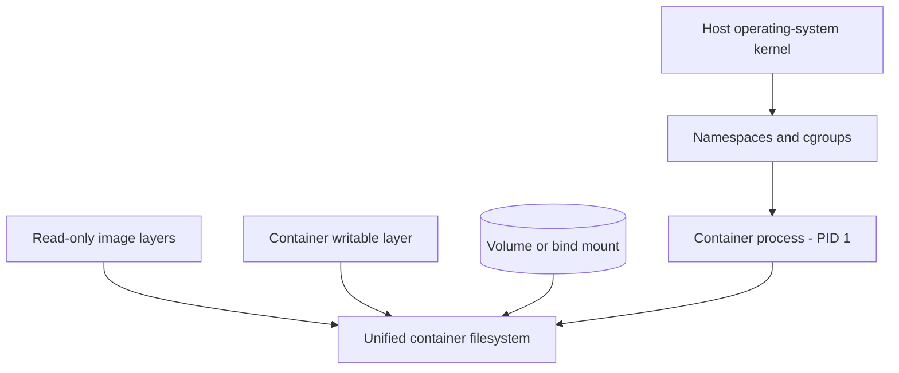
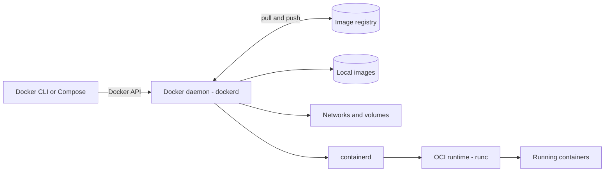
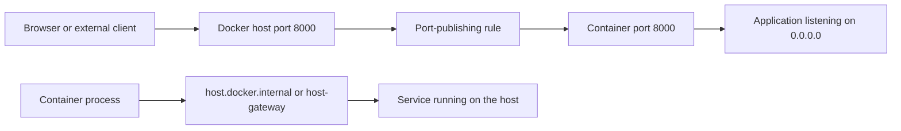
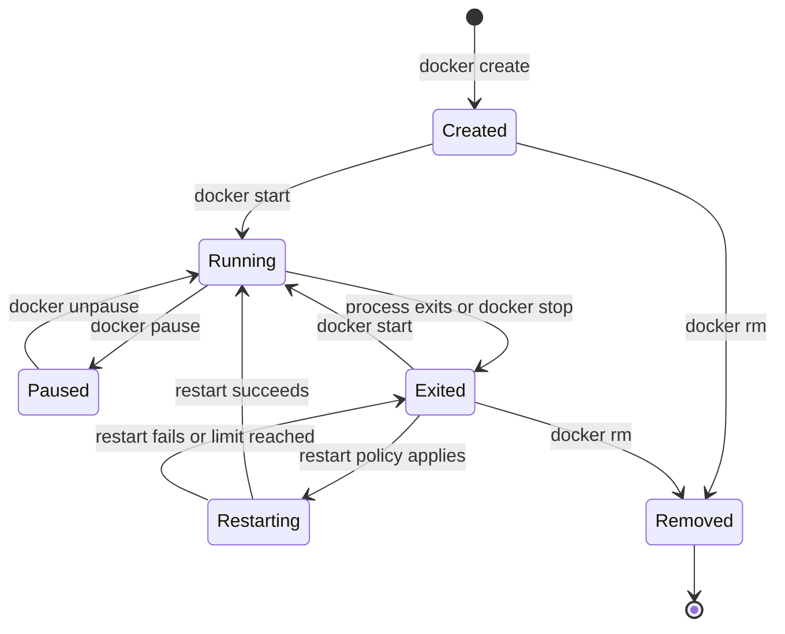

# Docker Interview Questions and Answers

### 1. Why do we need containers?

Containers solve the problem of running an application consistently across environments. They package the application code, runtime, libraries, and required configuration into a portable unit, reducing failures caused by differences between a developer's laptop, a test server, and production.

Unlike a virtual machine, a container does not include a complete guest operating system. Containers normally share the host's kernel while keeping their processes, networks, and filesystems isolated. This makes them quicker to start and generally less resource-intensive than virtual machines.

For example, a FastAPI service packaged as an image can use the same Python and dependency versions everywhere. Environment-specific settings, such as database URLs and credentials, should still be supplied at runtime rather than built into the image.

**Interview takeaway:** Containers improve portability, isolation, deployment consistency, and resource efficiency. They reduce environment drift, but they do not replace configuration management, security, monitoring, or persistent storage.

### 2. How does a container work?

A container is an isolated operating-system process. On Linux, the runtime uses namespaces to give the process isolated views of resources such as process IDs, networking, mounts, and hostnames. Control groups, commonly called cgroups, measure and limit resources such as CPU and memory.

The container filesystem is assembled from read-only image layers plus a thin writable layer created for that container. When the process writes a file, the change goes to the writable layer unless the path uses a volume or bind mount. Multiple containers can share image layers without sharing writable data.

Docker coordinates this through the Docker daemon, containerd, and an OCI-compatible runtime such as `runc`. The runtime creates the isolated process; the container does not boot a separate kernel.



The process shares the host kernel, while isolation controls what it can see and consume. The layered filesystem supplies application files, and mounted storage can outlive the writable container layer.

**Interview takeaway:** A container is process isolation built with kernel features, not a miniature VM. Namespaces isolate what a process can see, cgroups control what it can consume, and image layers supply its filesystem.

### 3. What is the difference between Linux and Windows containers?

Linux containers use Linux kernel features and require access to a Linux kernel. Windows containers use Windows kernel facilities and require a compatible Windows host. Because containers share a kernel, a Linux container cannot directly use a Windows kernel, and a Windows container cannot directly use a Linux kernel.

Docker Desktop runs Linux containers on Windows by providing a Linux kernel through WSL 2 or a managed virtual machine. The container is still a Linux container; Docker Desktop supplies the compatible kernel that Windows itself does not provide.

This distinction also affects images and binaries. An Ubuntu-based image expects Linux system calls, while a Windows Server Core image expects Windows APIs.

**Interview takeaway:** Container portability applies across hosts with a compatible kernel and architecture. Docker can hide some platform differences, but it cannot make an image independent of its operating-system family.

### 4. What is the difference between a Docker image and a container?

A Docker image is an immutable package containing filesystem layers and metadata such as default commands, environment variables, exposed ports, and labels. It is the template from which containers are created.

A container is a runtime instance of an image. Docker adds a writable layer, runtime configuration, networking, and an isolated process environment. Several containers can use the same image, and changes inside one do not alter the image or the other containers.

```bash
docker image pull nginx:1.27
docker run -d --name web-1 nginx:1.27
docker run -d --name web-2 nginx:1.27
```

Both containers share the image layers but have separate identities, processes, networks, and writable layers.

**Interview takeaway:** An image is the reusable blueprint; a container is an instance. Removing a container does not remove its image, and updating an image does not automatically replace existing containers.

### 5. What happens internally when a container starts?

Docker performs several coordinated steps:

1. Resolves and pulls the image if it is not available locally.
2. Mounts the read-only image layers and creates a writable layer.
3. Creates the required namespaces and cgroups.
4. Configures mounts, environment variables, networking, DNS, and ports.
5. Starts the configured `ENTRYPOINT` and `CMD` as the main process.

That process becomes PID 1 inside the container. The container normally remains running only while PID 1 is alive. If it exits, the container enters the exited state even if the host and Docker daemon are healthy.

PID 1 also has special responsibilities for signal handling and reaping child processes. Applications should handle termination signals so `docker stop` can shut them down gracefully.

**Interview takeaway:** Docker does not boot a complete OS for each container. It prepares isolation and storage, then starts the configured process.

### 6. What are the main Docker architecture components?

Docker uses a client-server architecture:

- **Docker client:** The `docker` CLI that sends API requests.
- **Docker daemon (`dockerd`):** Manages images, containers, networks, volumes, and API requests.
- **containerd and OCI runtime:** Manage lifecycle operations and create isolated processes.
- **Registry:** Stores and distributes images. Docker Hub is one example.
- **Docker objects:** Images, containers, networks, volumes, plugins, and metadata.

The client and daemon can run on different machines. A client can target a remote daemon through a Docker context, but access must be secured because control of the daemon is highly privileged.



The daemon is the control point: clients request operations, registries supply or receive images, and the runtime chain creates container processes.

**Interview takeaway:** The CLI is not the engine. It is a client of the daemon, which delegates low-level work to the container runtime and obtains images from registries.

### 7. What happens when you run a Docker command?

Consider:

```bash
docker run -d -p 8080:80 nginx:1.27
```

The client sends a request to the daemon. The daemon checks for the image locally and pulls it if necessary. It creates the writable layer, configures isolation and networking, maps host port `8080` to container port `80`, and asks the runtime to start the main process.

`docker run` is effectively a create followed by a start. In contrast, `docker start` starts an existing container and preserves its configuration.

**Interview takeaway:** Think of Docker commands as client-to-daemon API operations. This helps diagnose cases where the CLI is installed but cannot connect to a stopped engine.

### 8. Why do we need Docker images, and how are they built?

Images make application delivery repeatable. Instead of installing dependencies manually on every server, a team builds a versioned artifact once and deploys the same artifact through its environments.

`docker build` reads a Dockerfile and build context. Instructions such as `RUN` and `COPY` create filesystem content, while `CMD`, `ENTRYPOINT`, and `ENV` also contribute image configuration. BuildKit reuses cached results when an instruction and its relevant inputs have not changed.

```dockerfile
FROM python:3.12-slim
WORKDIR /app
COPY requirements.txt .
RUN pip install --no-cache-dir -r requirements.txt
COPY . .
CMD ["python", "app.py"]
```

Copying the dependency file first lets Docker reuse the dependency layer when only application code changes. A `.dockerignore` file should keep unnecessary or sensitive files out of the build context.

**Interview takeaway:** Images are immutable, versioned deployment artifacts. Dockerfile ordering affects caching, build speed, and final image size.

### 9. What is a hypervisor, and how is it different from Docker?

A hypervisor virtualizes hardware so multiple virtual machines can share one physical host. Each VM has virtual hardware and normally boots its own operating system and kernel. Type 1 hypervisors run directly on hardware; Type 2 hypervisors run through a host operating system.

Docker provides operating-system-level isolation. Linux containers on the same host share a Linux kernel and isolate their processes with kernel features, so they usually start faster and use fewer resources than full VMs.

The technologies are complementary. Cloud platforms often create Linux VMs for infrastructure isolation and then run many containers inside each VM.

**Interview takeaway:** A hypervisor abstracts hardware; a container runtime isolates processes. VMs offer a stronger boundary and broader OS flexibility, while containers offer higher density and faster lifecycle operations.

### 10. What is the difference between virtualization and containerization?

Virtualization creates independent machines above virtualized hardware. Each VM includes an operating system, kernel, libraries, and application. Containerization packages the application and user-space dependencies but normally shares the host kernel.

| Area | Virtual machine | Container |
|---|---|---|
| Isolation | Virtual hardware and guest OS | Processes and OS resources |
| Kernel | Separate guest kernel | Shared compatible host kernel |
| Startup | Usually slower | Usually faster |
| Size | Often gigabytes | Often smaller, workload-dependent |
| OS flexibility | Different guest OS families | Must match the supplied kernel family |
| Common use | Strong isolation and infrastructure boundaries | Application packaging and CI/CD |

Containers are not automatically secure. Security still depends on privileges, patching, image provenance, runtime controls, and configuration. Sharing a kernel creates a different isolation boundary from a VM.

**Interview takeaway:** Compare the abstraction layer and trade-offs rather than claiming one technology replaces the other.

### 11. Why do we need Docker Compose?

Docker Compose defines a multi-container application in one declarative file. It records how services are built or selected, how they communicate, which ports they publish, and which volumes and environment values they use.

```yaml
services:
  api:
    build: .
    ports:
      - "8000:8000"
    depends_on:
      - db
  db:
    image: postgres:16
    volumes:
      - pgdata:/var/lib/postgresql/data

volumes:
  pgdata:
```

`docker compose up -d` creates the required network, volume, and service containers. This makes local and test environments repeatable and provides a convenient description of the application topology.

Compose is not a cluster orchestrator: it does not provide Kubernetes-style scheduling, multi-node reconciliation, or rolling deployments.

**Interview takeaway:** A Dockerfile defines how to build one image; Compose defines how multiple services run together.

### 12. What is a Docker namespace?

A namespace is a Linux kernel feature that gives a process an isolated view of a resource. Docker combines several namespace types:

- **PID:** Isolates process ID trees.
- **Network:** Gives the container its own interfaces, routes, and ports.
- **Mount:** Isolates filesystem mount points.
- **UTS:** Isolates hostnames and domain names.
- **IPC:** Isolates interprocess communication resources.
- **User:** Can map container users to different host user IDs.

Namespaces answer, "What can this process see?" Cgroups answer, "How much can it consume?" Capabilities, seccomp, access-control systems, and filesystem permissions add further security controls.

**Interview takeaway:** Namespaces are a primary isolation mechanism, but they are only one part of container security.

### 13. When can data stored in a container be lost?

Data written to a container's writable layer survives a normal stop and start of that same container. It is lost when the container is removed, which commonly happens during recreation, replacement, or cleanup.

A database writing only inside `/var/lib/postgresql/data` loses that writable-layer data when its container is deleted. Mounting a named volume moves the data outside the container lifecycle:

```bash
docker run -d \
  --name database \
  -v pgdata:/var/lib/postgresql/data \
  postgres:16
```

Volumes are not backups. They can still be deleted, corrupted, or lost with the host. Important data needs an independent backup and recovery strategy.

**Interview takeaway:** Stopping is not removing. Use persistent storage for durable state and backups for disaster recovery.

### 14. What is the purpose of the volume option in `docker run`?

The volume option mounts storage at a path inside the container so data can exist independently of the writable layer. It can also share configuration, source code, sockets, or generated files between the host and container.

```bash
# Docker-managed named volume
docker run -v pgdata:/var/lib/postgresql/data postgres:16

# Host bind mount
docker run --mount type=bind,src="${PWD}",dst=/app python:3.12
```

Named volumes are managed by Docker and usually suit application data. Bind mounts expose a specific host path and are useful during development, but they couple the container to the host filesystem. `--mount` is more explicit, while `-v` is shorter.

Mount permissions should be restricted. Use `readonly` or `:ro` when the container does not need to write.

**Interview takeaway:** Choose named volumes for Docker-managed data and bind mounts when a known host path is required.

### 15. Where does Docker store persistent volume data?

On a typical Linux Docker Engine installation using the default data root, named volume contents commonly live below `/var/lib/docker/volumes`. This is an implementation detail, not a path applications should access directly.

Docker Desktop stores Linux-container volumes inside its managed Linux environment, not as ordinary Windows or macOS folders. Volume drivers can also store data elsewhere, including network or cloud storage.

Use Docker commands rather than guessing:

```bash
docker volume ls
docker volume inspect pgdata
```

**Interview takeaway:** Docker owns a named volume's placement. Manage it through Docker, and do not confuse persistence with backup.

### 16. How do you export and restore a Docker image archive?

Use `docker save` to archive images with their layers, tags, and metadata. Restore the archive with `docker load`:

```bash
docker save -o application.tar my-application:1.0
docker load -i application.tar
```

This is useful for offline environments or transferring an exact image without a registry.

`docker export` is different: it exports the current filesystem of a container without preserving normal image history and configuration. `docker import` creates a new flattened image from that archive.

**Interview takeaway:** `save`/`load` operate on images; `export`/`import` operate on a container filesystem snapshot.

### 17. How does a container communicate with its host?

The direction matters. For the host to reach a service in a bridge-networked container, publish a port:

```bash
docker run -p 8000:8000 my-api:1.0
```

The application inside the container must normally listen on `0.0.0.0`, not only `127.0.0.1`.

For a container to reach a host service, Docker Desktop provides `host.docker.internal`. On Linux, map it explicitly when needed:

```bash
docker run \
  --add-host=host.docker.internal:host-gateway \
  my-api:1.0
```

The host service must listen on a reachable address and permit the traffic through its firewall and authentication rules. Container-to-container traffic should normally use a user-defined network and service names.



The upper path represents host-to-container traffic through `-p 8000:8000`. The lower path represents a container initiating a connection to a service on its host.

**Interview takeaway:** Port publishing handles host-to-container access; a host gateway handles container-to-host access.

### 18. What does `docker info` show?

`docker info` reports daemon-wide state and configuration. It commonly includes container and image counts, server version, storage and logging drivers, cgroup settings, runtimes, kernel, operating system, CPU and memory capacity, registry settings, and security options.

Useful diagnostic commands include:

```bash
docker info
docker version
docker context show
```

`docker version` focuses on client and server version/API information. The context identifies the endpoint the CLI targets. If `docker info` shows client details followed by a connection error, the CLI is installed but cannot reach the daemon.

**Interview takeaway:** Use `docker info` for daemon state, `docker version` for compatibility, and contexts for endpoint selection.

### 19. What is the difference between `docker compose up`, `run`, and `start`?

`docker compose up` reconciles the project definition: it creates or recreates service containers and supporting resources when needed, then starts the services.

`docker compose run` creates a one-off container using a service's configuration. It is useful for migrations, tests, or an interactive shell:

```bash
docker compose run --rm api python manage.py migrate
```

By default, `run` does not publish the service's configured ports unless requested, helping avoid collisions with a running service.

`docker compose start` starts existing stopped service containers. It does not create missing containers or apply configuration changes.

**Interview takeaway:** Use `up` for the application, `run` for one-off work, and `start` when the required containers already exist.

### 20. What are the basic requirements for running Docker?

Docker requires a supported operating system, a compatible kernel or virtualization layer, sufficient CPU, memory, and storage, and permission to run the engine. Linux hosts run Linux containers against the host kernel. Windows and macOS commonly use Docker Desktop with a managed Linux environment.

Hardware virtualization and WSL 2 support may need to be enabled on Windows. Corporate policies can also affect proxies, certificates, registry access, networking, and virtualization.

Verify the complete client-to-engine path:

```bash
docker version
docker info
docker run --rm hello-world
```

Docker daemon access can be equivalent to administrative control of the host and should be restricted.

**Interview takeaway:** A working `docker --version` proves only that the CLI exists; it does not prove the engine is running or reachable.

### 21. How do you log in to a Docker registry?

Use `docker login` for Docker Hub or specify a private registry hostname:

```bash
docker login
docker login registry.example.com
```

For non-interactive use, avoid putting secrets in command arguments. Supply a token through standard input:

```bash
printf '%s' "$REGISTRY_TOKEN" | \
  docker login registry.example.com --username ci-user --password-stdin
```

Docker can store credentials through a credential helper. CI/CD pipelines should use short-lived or narrowly scoped tokens stored in the platform's secret manager. Use `docker logout registry.example.com` when credentials should be removed.

**Interview takeaway:** Registry authentication controls image pull and push access. Treat registry tokens as secrets and grant the minimum required permissions.

### 22. What are the most commonly used Dockerfile instructions?

Frequently used instructions include:

| Instruction | Purpose |
|---|---|
| `FROM` | Selects the base image and begins a build stage |
| `WORKDIR` | Sets the working directory |
| `COPY` | Copies files from the build context or another stage |
| `RUN` | Executes a command while building the image |
| `ARG` | Defines a build-time value |
| `ENV` | Sets an image/runtime environment value |
| `USER` | Selects the runtime user |
| `EXPOSE` | Documents intended ports; it does not publish them |
| `HEALTHCHECK` | Defines a command that reports container health |
| `ENTRYPOINT` | Defines the primary executable |
| `CMD` | Defines the default command or arguments |

A production Dockerfile often uses a multi-stage build to keep compilers and build tools out of the final image. Pinning suitable base-image versions and running as a non-root user can improve reproducibility and security.

**Interview takeaway:** Distinguish build-time filesystem changes from runtime metadata, and remember that `EXPOSE` does not publish a port.

### 23. What is the difference between `CMD` and `ENTRYPOINT`?

`ENTRYPOINT` defines the executable the image is designed to run. `CMD` defines either the default command or default arguments supplied to that entrypoint.

```dockerfile
ENTRYPOINT ["python", "app.py"]
CMD ["--port", "8000"]
```

Without extra arguments, this runs `python app.py --port 8000`. Arguments after the image name replace `CMD`:

```bash
docker run my-api:1.0 --port 9000
```

The exec form is usually preferred because it avoids an extra shell and provides more predictable signal handling. `--entrypoint` can explicitly replace the configured entrypoint.

**Interview takeaway:** Use `ENTRYPOINT` for the stable executable and `CMD` for overridable defaults. Without an `ENTRYPOINT`, `CMD` can be the complete default command.

### 24. What is the difference between Docker daemon logs and container logs?

Daemon logs describe the engine itself: startup failures, API activity, storage-driver errors, networking problems, runtime failures, and registry communication. Their location depends on the operating system and installation method; a Linux service may be inspected through `journalctl`.

Container logs represent the standard output and standard error of the main process as captured by the logging driver:

```bash
docker logs --tail 100 --follow my-api
```

`docker logs` does not automatically collect arbitrary log files written inside the container. Containerized applications commonly write operational logs to stdout and stderr, and production systems forward them to centralized storage.

**Interview takeaway:** For an engine problem, inspect daemon logs. For an application problem, inspect container logs and correlate them with container state, health, and resource metrics.

### 25. What is the difference between a Docker image and an image layer?

An image is the complete package identified by a name/tag or immutable digest. A layer is one content-addressed filesystem change used to assemble that image. Configuration such as the default command and environment is stored separately from filesystem layers.

Layers are immutable and can be shared between images. If two images use identical base layers, Docker normally stores and transfers that content once. Build cache can also reuse results when an instruction and all relevant inputs match.

Deleting a file in a later layer does not remove its bytes from an earlier layer; it only hides the file in the combined view. Secrets copied in one build step can therefore remain recoverable even if a later step deletes them.

**Interview takeaway:** Layering improves reuse and caching, but careless builds increase size or retain sensitive data. Use multi-stage builds and BuildKit secret mounts for sensitive inputs.

### 26. What is the difference between `COPY` and `ADD` in a Dockerfile?

Both add content to an image. `COPY` explicitly copies files and directories from the build context or another build stage. `ADD` has extra behavior, including automatic extraction of local tar archives and support for remote sources.

```dockerfile
COPY requirements.txt /app/
COPY --from=builder /build/application /usr/local/bin/application
```

Prefer `COPY` for ordinary application files because its behavior is easier to understand and review. Use `ADD` only when its extra behavior is intentional, such as extracting a local tar archive.

A remote download is often clearer with a dedicated download step that verifies integrity. Neither instruction can access files excluded from the build context.

**Interview takeaway:** `COPY` is the predictable default. `ADD` is not a better `COPY`; it carries extra semantics that should be used deliberately.

### 27. Can a Docker container restart automatically?

Yes. Docker supports restart policies through `--restart` or Compose:

- `no`: Do not restart automatically; this is the default.
- `on-failure[:max-retries]`: Restart after a non-zero exit, optionally with a limit.
- `always`: Restart after exits, with documented handling for manual stops.
- `unless-stopped`: Restart unless an operator explicitly stopped the container.

```bash
docker run -d --restart unless-stopped --name api my-api:1.0
```

Policies react to the main process exiting. They do not restart a running process merely because it returns HTTP 500 or becomes `unhealthy`. A Docker `HEALTHCHECK` reports health but does not itself restart the container.

Repeated restarts can hide a persistent failure, so monitor restart counts and logs.

**Interview takeaway:** A restart policy provides lifecycle recovery, not application healing. An orchestrator can add recovery based on health probes.

### 28. Can Docker Compose use JSON instead of YAML?

Yes. Current Docker Compose implementations accept JSON representing the Compose data model, although YAML is the conventional authoring format. Specify a JSON file explicitly:

```json
{
  "services": {
    "api": {
      "image": "my-api:1.0",
      "ports": ["8000:8000"]
    }
  }
}
```

```bash
docker compose -f compose.json up -d
```

YAML is generally easier for humans to read and supports comments. JSON can be useful when another tool generates the configuration. Validate either representation with `docker compose config`.

**Interview takeaway:** Compose can parse JSON, but YAML is the normal choice for maintained Compose files.

### 29. How many containers can run on one Docker host?

Docker does not define one universal maximum. The practical limit is reached when workloads exhaust or contend for host resources and operating-system limits.

Important constraints include:

- CPU usage and scheduling contention.
- Working memory, page cache, and out-of-memory behavior.
- Disk capacity and I/O from images, writable layers, volumes, and logs.
- Network bandwidth, connections, and available ports.
- Process IDs, file descriptors, and other kernel limits.
- Per-container traffic, workload behavior, and startup spikes.

One hundred idle containers may use less than one memory-intensive model-serving container. Measure the actual workload:

```bash
docker stats
docker inspect my-container
```

Apply appropriate limits and load test under realistic traffic while leaving headroom for the host and failure scenarios.

**Interview takeaway:** Capacity planning is a resource and reliability problem, not a fixed container-count limit.

### 30. What is the Docker container lifecycle?

A container moves through states based on creation and the main process:

1. **Created:** Configuration and writable layer exist, but the process has not started.
2. **Running:** The main process is executing.
3. **Paused:** Processes are temporarily suspended.
4. **Exited:** The main process stopped and an exit code was recorded.
5. **Restarting:** Docker is restarting it under a restart policy.
6. **Removed:** Metadata and the writable layer have been deleted.



```bash
docker create --name web nginx:1.27
docker start web
docker pause web
docker unpause web
docker stop web
docker rm web
```

`docker run` creates and starts a new container. `docker start` starts an existing stopped container. A removed container cannot be restarted, though a replacement can be created from the same image.

**Interview takeaway:** State follows PID 1. Stopping preserves the writable layer; removing deletes it but normally leaves separately managed named volumes.

### 31. How do you use Docker across multiple application environments?

Build one immutable image and promote that exact image through testing, staging, and production. Environment-specific behavior should come from runtime configuration rather than separate source builds.

Configuration can be provided through environment variables, mounted files, Compose overrides, secrets, or the deployment platform:

```bash
docker run -d \
  --name api-production \
  --env-file production.env \
  my-api:1.0
```

For production, replace the tag with the real immutable digest reported by the registry or `docker image inspect`, using the form `my-api@sha256:<digest>`. A digest identifies the tested artifact exactly. Secrets should come from a protected secret-management mechanism and should not be committed to an environment file or embedded in the image.

Development may use bind mounts and debugging tools, while production adds stricter permissions, resource limits, observability, persistent storage, and controlled rollout. Those runtime differences should not require a different application build.

**Interview takeaway:** Build once and configure at runtime. This reduces drift and makes promotion, rollback, and auditing more reliable.

### 32. How do you ensure one service starts before another in Docker Compose?

Use `depends_on` to express dependency order. The short form starts the dependency container first, but a started container is not necessarily ready to accept connections.

For readiness-sensitive dependencies, add a health check and use `condition: service_healthy`:

```yaml
services:
  db:
    image: postgres:16
    environment:
      POSTGRES_PASSWORD: example-only
    healthcheck:
      test: ["CMD-SHELL", "pg_isready -U postgres"]
      interval: 5s
      timeout: 3s
      retries: 10
      start_period: 10s

  api:
    image: my-api:1.0
    depends_on:
      db:
        condition: service_healthy
```

This delays the dependent service until the health check succeeds, but it does not guarantee the database will remain available afterward.

The application must still handle transient failures with bounded retries, backoff, timeouts, and clear error reporting. Startup ordering alone is not a resilience strategy.

**Interview takeaway:** `depends_on` controls order, health checks improve readiness coordination, and application retry logic handles runtime failure.
