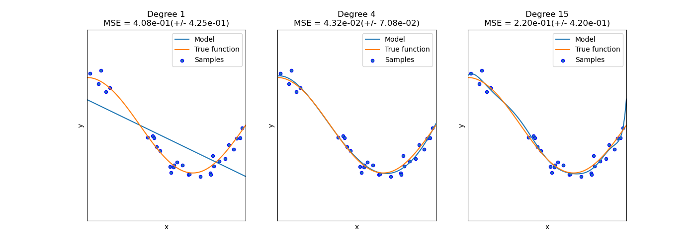
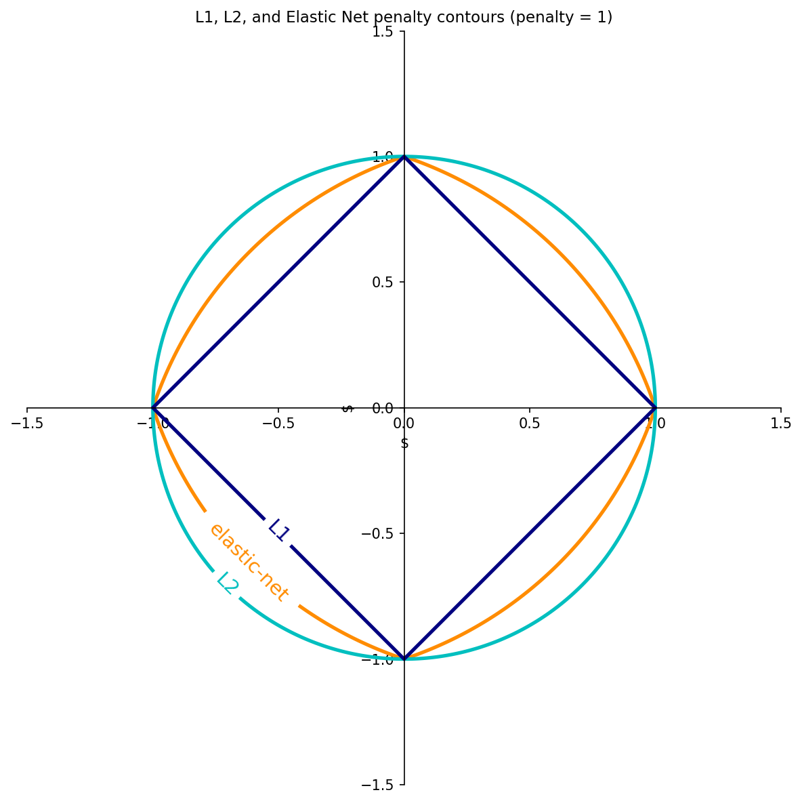
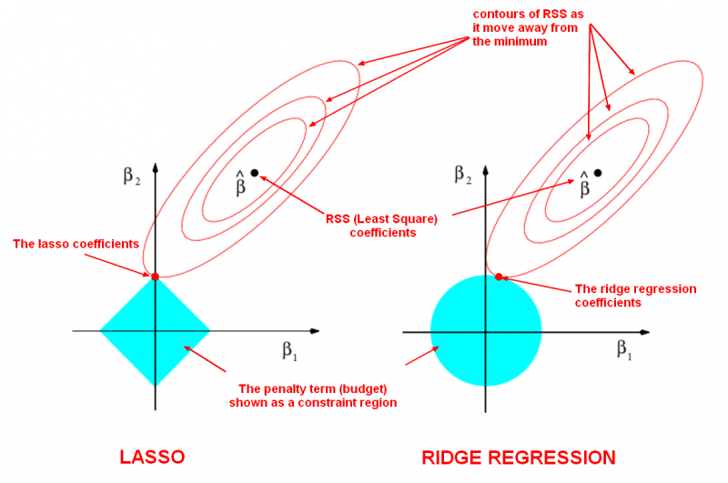
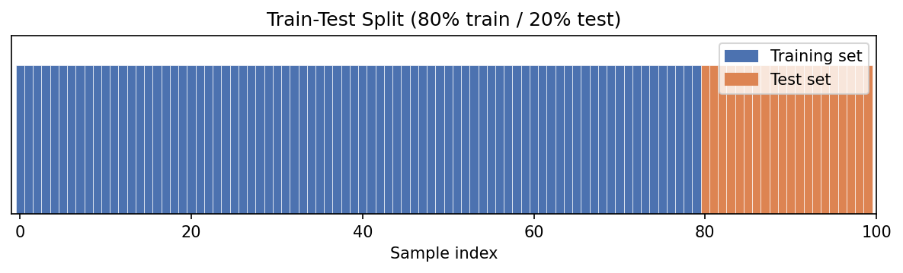
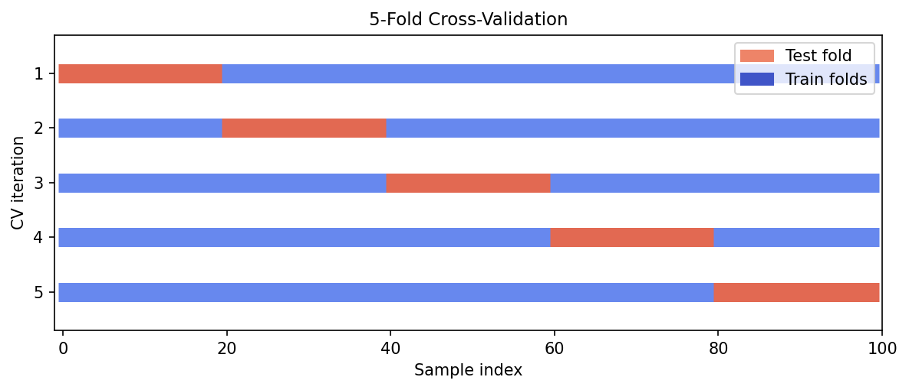
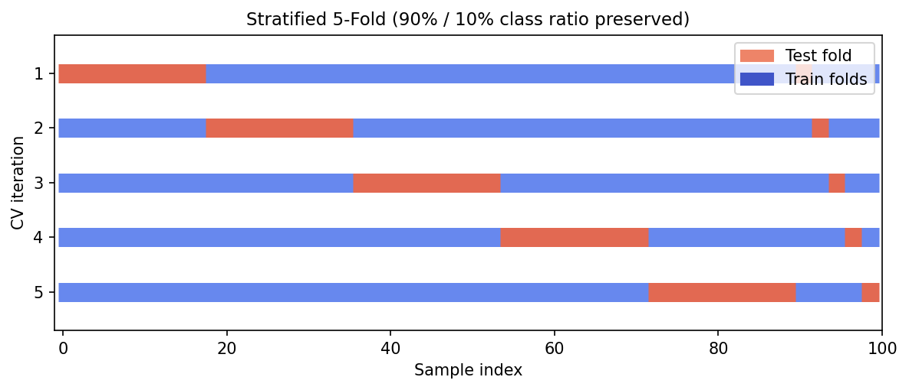
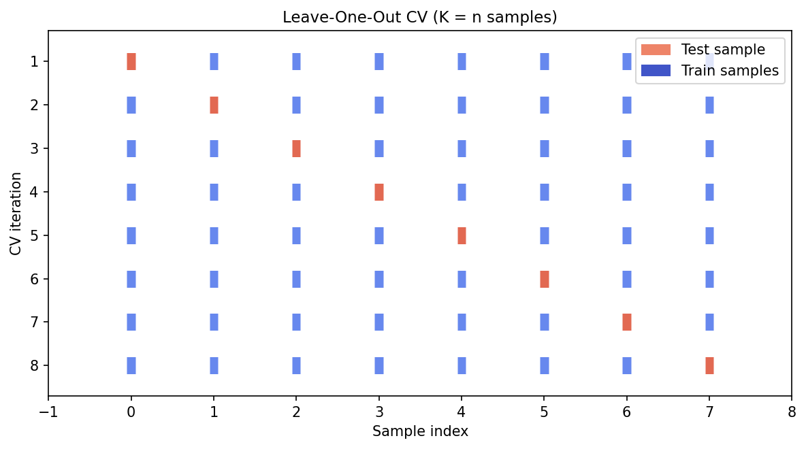
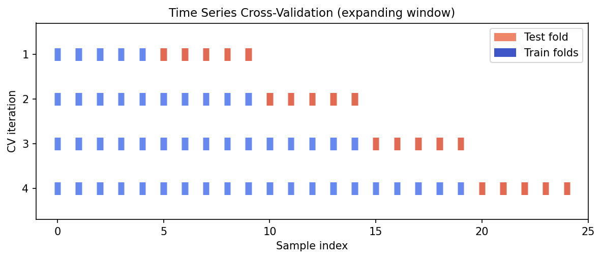
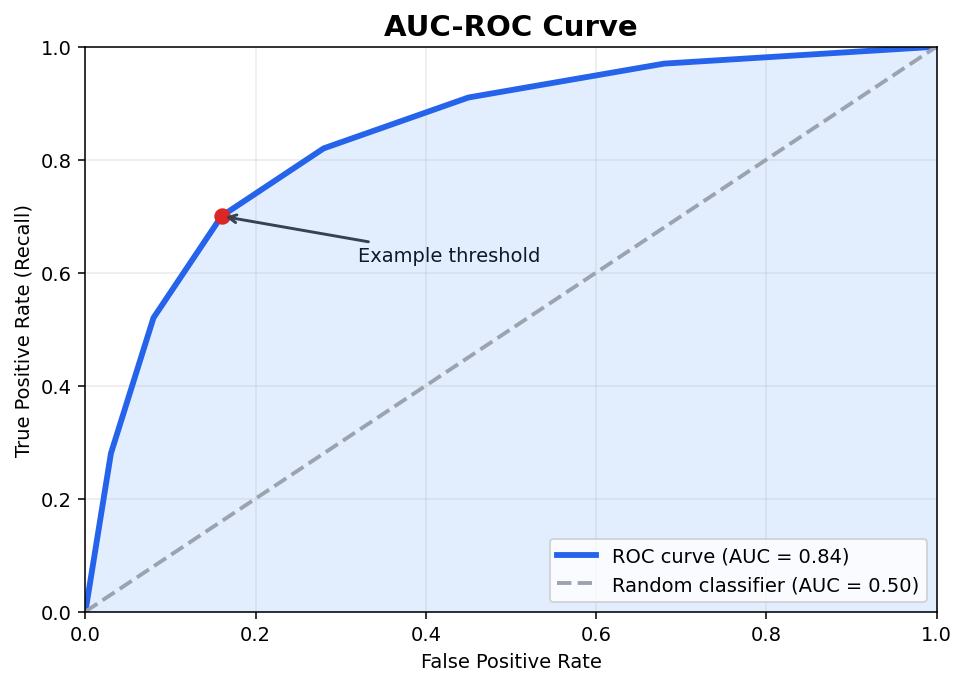

## Question

1. What is **overfitting** in machine learning? How can you recognize it, and what techniques help prevent it?

## Answer

**Overfitting** occurs when a machine learning model learns not only the underlying patterns in the training data but also the noise and random fluctuations. As a result:

- **Training accuracy:** Very high
- **Test/Validation accuracy:** Low

The model performs well on data it has seen but fails to generalize to unseen data.



*Source: [scikit-learn — Underfitting vs. Overfitting](https://scikit-learn.org/stable/auto_examples/model_selection/plot_underfitting_overfitting.html)*

The diagram shows the same noisy data fit with three polynomial models:

- **Degree 1 (left):** Too simple — underfitting (high bias).
- **Degree 4 (middle):** Tracks the true function well — good generalization.
- **Degree 15 (right):** Wiggles through every training point — overfitting (high variance).

### Example

Imagine predicting house prices.

- A good model learns that **larger houses generally cost more**.
- An overfit model also learns that **the third house in the dataset had a blue door and cost $500,000**, treating that coincidence as an important pattern.

This hurts performance on new houses.

### Signs of Overfitting

- Very low training error but high validation/test error.
- Large gap between training and validation accuracy.
- Model complexity is too high compared to the amount of data.

### How to Avoid Overfitting


| Technique                     | Description                                                                                  |
| ----------------------------- | -------------------------------------------------------------------------------------------- |
| **More training data**        | Gives the model more representative examples and reduces memorization.                       |
| **Cross-validation**          | Ensures the model generalizes well across different data splits.                             |
| **Regularization (L1/L2)**    | Penalizes large weights, encouraging simpler models.                                         |
| **Reduce model complexity**   | Use fewer features, shallower trees, or fewer neural network layers.                         |
| **Pruning (Decision Trees)**  | Remove branches that capture noise instead of useful patterns.                               |
| **Early stopping**            | Stop training when validation performance stops improving.                                   |
| **Dropout (Neural Networks)** | Randomly deactivate neurons during training to prevent co-adaptation.                        |
| **Feature selection**         | Remove irrelevant or redundant features.                                                     |
| **Data augmentation**         | Create additional training examples (common for images, audio, text).                        |
| **Ensemble methods**          | Methods like Random Forest or Gradient Boosting often generalize better than a single model. |


### Bias-Variance Perspective

Overfitting is a **high variance** problem:

- The model is overly sensitive to the training data.
- Small changes in the training set can lead to very different predictions.

### Interview Answer (30–45 seconds)

> "Overfitting occurs when a model learns the training data too well, including noise and outliers, instead of the underlying patterns. It results in high training accuracy but poor performance on unseen data. We can prevent overfitting by using more training data, cross-validation, regularization techniques like L1/L2, reducing model complexity, early stopping, dropout in neural networks, pruning decision trees, feature selection, and data augmentation. The goal is to build a model that generalizes well rather than memorizing the training data."

---


## Question

2. What is **underfitting** in machine learning? How can you recognize it, and what techniques help prevent it?

## Answer

**Underfitting** occurs when a machine learning model is **too simple** to capture the underlying patterns in the data. As a result, it performs poorly on both the training data and unseen test data.

- **Training accuracy:** Low
- **Test/Validation accuracy:** Low

The model fails to learn the relationships in the data.


*Source: [scikit-learn — Underfitting vs. Overfitting](https://scikit-learn.org/stable/auto_examples/model_selection/plot_underfitting_overfitting.html)*

The left panel (degree 1) is a straight line that cannot follow the curve — classic underfitting.

### Example

Imagine predicting house prices.

- A good model learns that factors like **size, location, and number of bedrooms** influence price.
- An underfit model might simply predict the **average house price for every house**, ignoring all the features.

This leads to poor predictions for both training and new data.

### Signs of Underfitting

- High training error.
- High validation/test error.
- Training and validation performance are both poor and close to each other.
- The model has high bias.

### How to Avoid Underfitting


| Technique                      | Description                                                                                                                              |
| ------------------------------ | ---------------------------------------------------------------------------------------------------------------------------------------- |
| **Increase model complexity**  | Use a more powerful model (e.g., deeper neural network, deeper decision tree).                                                           |
| **Add more relevant features** | Provide the model with more useful information.                                                                                          |
| **Reduce regularization**      | Lower L1/L2 penalties if they are preventing learning.                                                                                   |
| **Train for more epochs**      | Neural networks may need more training time to converge.                                                                                 |
| **Feature engineering**        | Create meaningful features or polynomial features to capture complex relationships.                                                      |
| **Use a better algorithm**     | Switch from a simple model (e.g., Linear Regression) to a more expressive one (e.g., Random Forest or Gradient Boosting) if appropriate. |
| **Hyperparameter tuning**      | Optimize parameters such as tree depth, learning rate, or number of estimators.                                                          |


### Bias-Variance Perspective

Underfitting is a **high bias** problem:

- The model makes overly simplistic assumptions.
- It cannot capture the true relationship between inputs and outputs.

### Overfitting vs. Underfitting


| Aspect            | Underfitting | Overfitting |
| ----------------- | ------------ | ----------- |
| Model complexity  | Too simple   | Too complex |
| Training accuracy | Low          | Very high   |
| Test accuracy     | Low          | Low         |
| Training error    | High         | Very low    |
| Test error        | High         | High        |
| Bias              | High         | Low         |
| Variance          | Low          | High        |


### Interview Answer (30–45 seconds)

> "Underfitting occurs when a model is too simple to learn the underlying patterns in the data, resulting in poor performance on both training and test datasets. It is a high-bias problem. We can reduce underfitting by increasing model complexity, adding relevant features, reducing excessive regularization, training for more epochs, performing feature engineering, tuning hyperparameters, or using a more expressive algorithm. The goal is to make the model flexible enough to capture the true patterns without becoming so complex that it overfits."

---


## Question

3. What is **regularization** in machine learning? Why is it needed, and what are the main types?

## Answer

**Regularization** is a technique used to **prevent overfitting** by adding a penalty to the model's loss function. This discourages the model from learning overly complex patterns and helps it generalize better to unseen data.

### Why is it Needed?

Without regularization:

- The model may assign very large weights to some features.
- It starts fitting noise in the training data.
- Training accuracy becomes very high, but test accuracy drops.

Regularization keeps the model simpler by penalizing large weights.

### Mathematical Form

Original loss function:

$$
\mathcal{L}(\mathbf{w}) = \text{Prediction Error}
$$

With regularization:

$$
\mathcal{L}(\mathbf{w}) = \text{Prediction Error} + \lambda \cdot \text{Penalty}(\mathbf{w})
$$

where:

- **$\lambda$ (lambda)** controls the strength of regularization.
- Larger $\lambda$ → simpler model (higher bias, lower variance).
- Smaller $\lambda$ → model focuses more on fitting the training data.

### Types of Regularization



*Source: [scikit-learn — SGD: Penalties](https://scikit-learn.org/stable/auto_examples/linear_model/plot_sgd_penalties.html)*

#### 1. L1 Regularization (Lasso)

Penalty:

$$
\text{Penalty}_{\text{L1}} = \lambda \sum_{i=1}^{p} \lvert w_i \rvert
$$

**Characteristics:**

- Uses the absolute value of weights.
- Can shrink some weights exactly to **0**.
- Performs **feature selection** automatically.
- Useful when many features are irrelevant.

**Example:**

```
Before:
Age = 2.1
Salary = 0.8
ZipCode = 0.5

After L1:
Age = 2.0
Salary = 0.6
ZipCode = 0
```

#### 2. L2 Regularization (Ridge)

Penalty:

$$
\text{Penalty}_{\text{L2}} = \lambda \sum_{i=1}^{p} w_i^2
$$

**Characteristics:**

- Uses squared weights.
- Reduces weights but rarely makes them exactly zero.
- Keeps all features while preventing any single feature from dominating.
- Most commonly used regularization technique.

#### 3. Elastic Net

Combines both L1 and L2:

$$
\mathcal{L}(\mathbf{w}) = \text{Error} + \lambda_1 \sum_{i=1}^{p} \lvert w_i \rvert + \lambda_2 \sum_{i=1}^{p} w_i^2
$$

Used when:

- There are many correlated features.
- You want both feature selection (L1) and stable coefficients (L2).

### Effect of $\lambda$ (Lambda)


| $\lambda$ | Effect                                        |
| --------- | --------------------------------------------- |
| $\lambda = 0$ | No regularization; higher risk of overfitting |
| Small $\lambda$ | Slight penalty; good balance                  |
| Large $\lambda$ | Simpler model; may underfit if too large      |


### Intuition

Imagine you're drawing a curve through data points.

- **Without regularization:** The curve twists and bends to pass through nearly every point (overfitting).
- **With regularization:** The curve is smoother and captures the overall trend rather than the noise.

Geometrically, regularization restricts coefficients to a constraint region. The optimal solution is where the loss contours first touch that region:



*Source: [ethen8181 — Regularization](http://ethen8181.github.io/machine-learning/regularization/regularization.html)*

- **Lasso (diamond):** Sharp corners on the axes → intersection often sets a coefficient to **exactly zero** (feature selection).
- **Ridge (circle):** Smooth boundary → coefficients shrink but **rarely become zero**.

### Interview Answer (30–45 seconds)

> "Regularization is a technique used to prevent overfitting by adding a penalty term to the loss function. This penalty discourages the model from assigning very large weights to features, resulting in a simpler model that generalizes better. The two main types are **L1 (Lasso)**, which can shrink some feature weights to zero and perform feature selection, and **L2 (Ridge)**, which reduces weights without eliminating features. The regularization strength is controlled by the lambda parameter—higher lambda means stronger regularization."

---


## Question

4. Explain **Lasso** and **Ridge** regularization. How do they help in **Elastic Net** regularization?

## Answer

### 1. Lasso Regularization (L1)

Lasso adds the **absolute value of the coefficients** as a penalty to the loss function.

**Formula:**

$$
\mathcal{L}(\mathbf{w}) = \text{MSE} + \lambda \sum_{i=1}^{p} \lvert w_i \rvert
$$

#### What does Lasso do?

- Shrinks coefficient values.
- Can make some coefficients **exactly zero**.
- Automatically performs **feature selection**.
- Produces a simpler, more interpretable model.

**Example:**


| Feature  | Before | After Lasso |
| -------- | ------ | ----------- |
| Age      | 2.4    | 2.1         |
| Salary   | 1.8    | 1.2         |
| Zip Code | 0.6    | **0**       |


Here, **Zip Code** is removed from the model.

**Best when:**

- Many features are irrelevant.
- You want automatic feature selection.

### 2. Ridge Regularization (L2)

Ridge adds the **square of the coefficients** as a penalty.

**Formula:**

$$
\mathcal{L}(\mathbf{w}) = \text{MSE} + \lambda \sum_{i=1}^{p} w_i^2
$$

#### What does Ridge do?

- Shrinks coefficients toward zero.
- Rarely makes coefficients exactly zero.
- Keeps all features in the model.
- Reduces variance and improves generalization.

**Example:**


| Feature  | Before | After Ridge |
| -------- | ------ | ----------- |
| Age      | 2.4    | 2.1         |
| Salary   | 1.8    | 1.5         |
| Zip Code | 0.6    | 0.3         |


All features remain, but their influence is reduced.

**Best when:**

- Most features are useful.
- Features are highly correlated (multicollinearity).

### Key Differences


*Source: [ethen8181 — Regularization](http://ethen8181.github.io/machine-learning/regularization/regularization.html)*


| Aspect                    | Lasso (L1)             | Ridge (L2)            |
| ------------------------- | ---------------------- | --------------------- |
| Penalty                   | $\sum_{i=1}^{p} \lvert w_i \rvert$ | $\sum_{i=1}^{p} w_i^2$ |
| Feature selection         | ✅ Yes                  | ❌ No                  |
| Coefficients become zero  | ✅ Yes                  | ❌ Rarely              |
| Handles multicollinearity | Good                   | Excellent             |
| Model complexity          | Simpler                | Keeps all features    |


### Elastic Net Regularization

Elastic Net combines **both Lasso and Ridge** penalties.


*Source: [scikit-learn — SGD: Penalties](https://scikit-learn.org/stable/auto_examples/linear_model/plot_sgd_penalties.html)*

#### Formula

$$
\mathcal{L}(\mathbf{w}) = \text{MSE} + \lambda_1 \sum_{i=1}^{p} \lvert w_i \rvert + \lambda_2 \sum_{i=1}^{p} w_i^2
$$

or equivalently,

$$
\mathcal{L}(\mathbf{w}) = \text{MSE} + \lambda \left( \alpha \sum_{i=1}^{p} \lvert w_i \rvert + (1 - \alpha) \sum_{i=1}^{p} w_i^2 \right)
$$

where:

- **$\lambda$** controls the overall regularization strength.
- **$\alpha$** controls the mix:
  - $\alpha = 1$ → Lasso
  - $\alpha = 0$ → Ridge
  - $0 < \alpha < 1$ → Elastic Net

### Why Combine Lasso and Ridge?

Lasso has a limitation:

- If several features are highly correlated, it may keep only one and discard the others.

Ridge has a limitation:

- It keeps all features, including irrelevant ones.

Elastic Net combines their strengths:

- Performs feature selection (Lasso).
- Handles correlated features better (Ridge).
- Produces more stable models than Lasso alone.

### Example

Suppose you're predicting house prices with features:

- Size
- Number of rooms
- Living area
- Total built-up area
- Garage

Here, **Size**, **Living area**, and **Built-up area** are highly correlated.

- **Lasso:** Might keep only **Size** and remove the other two.
- **Ridge:** Keeps all three but shrinks their coefficients.
- **Elastic Net:** Keeps the important correlated features while shrinking them appropriately and removing only truly irrelevant ones (e.g., Garage if it adds little value).

### When to Use


| Situation                         | Recommended Method |
| --------------------------------- | ------------------ |
| Many irrelevant features          | Lasso              |
| Highly correlated features        | Ridge              |
| Many features + multicollinearity | Elastic Net        |


### Interview Answer (45–60 seconds)

> "Lasso, or L1 regularization, adds the absolute value of coefficients as a penalty, which can shrink some coefficients to exactly zero. This makes it useful for automatic feature selection. Ridge, or L2 regularization, adds the squared value of coefficients, reducing their magnitude without eliminating features. It's particularly effective when features are highly correlated. Elastic Net combines both L1 and L2 penalties, giving us the benefits of feature selection from Lasso and the stability of Ridge. It's commonly used for high-dimensional datasets where there are many correlated features."

---


## Question

5. What are different **model evaluation techniques** in machine learning? When should you use each one?

## Answer

Model evaluation techniques help determine **how well a machine learning model generalizes to unseen data**. The choice depends on the dataset size, model type, and problem (classification or regression).

### 1. Train-Test Split

The dataset is divided into:

- **Training set** (e.g., 80%) to train the model.
- **Test set** (e.g., 20%) to evaluate performance.

**Example:**

- 10,000 samples
- 8,000 for training
- 2,000 for testing



#### Advantages

- Simple and fast.
- Suitable for large datasets.

#### Disadvantages

- Performance depends on one random split.
- Can be misleading if the split is not representative.

### 2. K-Fold Cross-Validation

The dataset is divided into **K equal parts (folds)**.

For each iteration:

- Train on **K−1 folds**.
- Test on the remaining fold.
- Repeat until every fold has been used as the test set.
- Average the performance across all folds.

Example with **5-fold CV**:

```
Fold 1 → Test
Fold 2-5 → Train

Fold 2 → Test
Fold 1,3,4,5 → Train

...

Average all 5 scores
```



*Source: [scikit-learn — Visualizing cross-validation behavior](https://scikit-learn.org/stable/auto_examples/model_selection/plot_cv_indices.html)*

#### Advantages

- More reliable than a single train-test split.
- Uses all data for both training and testing.
- Reduces variance in performance estimates.

#### Disadvantages

- Computationally expensive.

### 3. Stratified K-Fold Cross-Validation

Used mainly for **classification** problems.

Each fold preserves the **same class distribution** as the original dataset.

Example:

Original dataset:

```
90% Negative
10% Positive
```

Each fold will also contain approximately:

```
90% Negative
10% Positive
```



*Source: [scikit-learn — Visualizing cross-validation behavior](https://scikit-learn.org/stable/auto_examples/model_selection/plot_cv_indices.html)*

#### Why use it?

Without stratification, some folds may contain very few or no minority-class samples, leading to unreliable evaluation.

### 4. Leave-One-Out Cross-Validation (LOOCV)

Special case of K-Fold where:

$$
K = n \text{ (number of samples)}
$$

If there are **100 samples**:

- Train on 99.
- Test on 1.
- Repeat 100 times.



*Source: [scikit-learn — Visualizing cross-validation behavior](https://scikit-learn.org/stable/auto_examples/model_selection/plot_cv_indices.html)*

#### Advantages

- Makes maximum use of available data.
- Good for very small datasets.

#### Disadvantages

- Very slow for large datasets.
- High computational cost.

### 5. Repeated K-Fold Cross-Validation

Runs K-Fold multiple times using different random splits.

Example:

```
5-Fold × 10 repetitions
```

Produces a more stable estimate of model performance by reducing the effect of any single random split.

### 6. Time Series Cross-Validation (Rolling/Forward Validation)

Used for **time-dependent data**.

You **cannot randomly shuffle** time series data because it would leak future information into the past.

Example:

```
Train: Jan-Feb
Test : Mar

Train: Jan-Mar
Test : Apr

Train: Jan-Apr
Test : May
```

This respects the chronological order of observations.



*Source: [scikit-learn — Visualizing cross-validation behavior](https://scikit-learn.org/stable/auto_examples/model_selection/plot_cv_indices.html)*

### Common Evaluation Metrics

#### Classification

- **Accuracy**
- **Precision**
- **Recall**
- **F1 Score**
- **ROC-AUC**
- **Log Loss**
- **Confusion Matrix**

#### Regression

- **Mean Absolute Error (MAE)**
- **Mean Squared Error (MSE)**
- **Root Mean Squared Error (RMSE)**
- **R² Score (Coefficient of Determination)**

### Comparison Table


| Technique         | Best For                  | Advantages                        | Disadvantages                         |
| ----------------- | ------------------------- | --------------------------------- | ------------------------------------- |
| Train-Test Split  | Large datasets            | Fast and simple                   | Performance depends on one split      |
| K-Fold CV         | General ML                | Reliable estimate                 | More computationally expensive        |
| Stratified K-Fold | Imbalanced classification | Preserves class distribution      | Slightly more complex                 |
| LOOCV             | Very small datasets       | Uses almost all data for training | Extremely slow for large datasets     |
| Repeated K-Fold   | Robust evaluation         | Reduces randomness                | Higher computation                    |
| Time Series CV    | Time-dependent data       | Prevents data leakage             | Not suitable for non-time-series data |


### Which One Should You Use?


| Dataset/Scenario          | Recommended Technique        |
| ------------------------- | ---------------------------- |
| Large dataset             | Train-Test Split             |
| Medium-sized dataset      | K-Fold Cross-Validation      |
| Imbalanced classification | Stratified K-Fold            |
| Small dataset             | LOOCV                        |
| Time series forecasting   | Time Series Cross-Validation |


### Interview Answer (60–90 seconds)

> "Model evaluation techniques measure how well a model generalizes to unseen data. The simplest approach is a train-test split, where the data is divided into training and testing sets. A more reliable method is K-Fold Cross-Validation, where the data is split into K folds and each fold is used once for testing. For imbalanced classification problems, Stratified K-Fold ensures each fold maintains the original class distribution. For very small datasets, Leave-One-Out Cross-Validation trains on all but one sample in each iteration. For time-series data, we use forward or rolling validation to preserve the temporal order and avoid data leakage. After evaluation, we use metrics such as Accuracy, Precision, Recall, F1 Score, and ROC-AUC for classification, or MAE, RMSE, and R² for regression."
---


## Question

6. Can you explain the **Confusion Matrix**? What is the difference between **Precision** and **Recall**, and how does the **F1-Score** combine these two metrics?

## Answer

A **Confusion Matrix** is a table used to evaluate the performance of a classification model by comparing the model's predictions with the actual outcomes.

|                     |  Predicted Positive |  Predicted Negative |
| ------------------- | ------------------: | ------------------: |
| **Actual Positive** |  True Positive (TP) | False Negative (FN) |
| **Actual Negative** | False Positive (FP) |  True Negative (TN) |

- **True Positive (TP):** Model correctly predicts a positive case.
- **True Negative (TN):** Model correctly predicts a negative case.
- **False Positive (FP):** Model incorrectly predicts a positive case (Type I error).
- **False Negative (FN):** Model incorrectly predicts a negative case (Type II error).

### Precision vs Recall

Although both measure classification performance, they answer different questions.

#### Precision

**Question answered:** *Out of all the instances predicted as positive, how many were actually positive?*

$$
\text{Precision} = \frac{TP}{TP + FP}
$$

- High precision means **few false positives**.
- Important when the cost of a false positive is high.

**Example:** Email spam detection. If a legitimate email is marked as spam, that is undesirable, so high precision is important.

#### Recall

**Question answered:** *Out of all the actual positive instances, how many did the model correctly identify?*

$$
\text{Recall} = \frac{TP}{TP + FN}
$$

- High recall means **few false negatives**.
- Important when missing a positive case is costly.

**Example:** Cancer detection. Missing a patient who actually has cancer is much worse than raising a few false alarms.

### Precision vs Recall Summary

| Precision                                          | Recall                                     |
| -------------------------------------------------- | ------------------------------------------ |
| Focuses on prediction quality                      | Focuses on finding all positive cases      |
| Minimizes False Positives                          | Minimizes False Negatives                  |
| "When I predict positive, how often am I correct?" | "Did I find most of the actual positives?" |

### F1-Score

The **F1-Score** combines both Precision and Recall into a single metric using their **harmonic mean**.

$$
F1 = \frac{2 \times (\text{Precision} \times \text{Recall})}{\text{Precision} + \text{Recall}}
$$

Why the **harmonic mean** instead of the average?

- The harmonic mean penalizes extreme values.
- If either Precision or Recall is low, the F1-score will also be low.
- This ensures that a model performs well on both metrics rather than excelling in only one.

**Example:**

- Precision = 0.90
- Recall = 0.50

Arithmetic Mean = **0.70**

F1-Score:

$$
\frac{2 \times 0.9 \times 0.5}{0.9 + 0.5} \approx 0.64
$$

The F1-score is lower because the poor recall reduces the overall performance.

### Interview Takeaway (30-second answer)

> "A confusion matrix summarizes a classifier's predictions into True Positives, True Negatives, False Positives, and False Negatives. Precision measures how accurate the positive predictions are, while Recall measures how many actual positive cases the model successfully identifies. Since there is often a trade-off between Precision and Recall, we use the F1-score, which is the harmonic mean of both, to provide a balanced evaluation, especially for imbalanced datasets where accuracy alone can be misleading."
---


## Question

7. Can you explain the different types of **loss functions** used in Machine Learning? When should each one be used?

## Answer

A **loss function** measures how far a model's predictions are from the actual values. During training, the model tries to **minimize the loss** by updating its parameters using optimization algorithms such as Gradient Descent.

The choice of loss function depends on the type of problem: **regression**, **classification**, or **specialized tasks**.

### 1. Regression Loss Functions

These are used when predicting **continuous numerical values**.

#### a) Mean Squared Error (MSE)

**Formula:**

$$
MSE = \frac{1}{N}\sum (y_{true}-y_{pred})^2
$$

**Characteristics**

- Squares the error, heavily penalizing large mistakes.
- Smooth and differentiable.
- Sensitive to outliers.

**Example**
Predicting house prices where a $100,000 error should be penalized much more than a $10,000 error.

**Used in**

- Linear Regression
- Neural Networks for regression

#### b) Root Mean Squared Error (RMSE)

$$
RMSE=\sqrt{MSE}
$$

**Characteristics**

- Same behavior as MSE.
- Easier to interpret because it is in the same units as the target variable.

**Example**
Predicting temperatures or stock prices.

#### c) Mean Absolute Error (MAE)

$$
MAE=\frac{1}{N}\sum |y_{true}-y_{pred}|
$$

**Characteristics**

- Penalizes errors linearly.
- More robust to outliers than MSE.
- Less sensitive to extremely large errors.

**Example**
Predicting delivery time where occasional extreme delays should not dominate training.

#### d) Huber Loss

Huber Loss combines the advantages of **MSE** and **MAE**.

- Uses MSE for small errors.
- Switches to MAE for large errors.

**Advantages**

- Less affected by outliers.
- Stable optimization.

**Example**
Financial forecasting with noisy data.

### 2. Classification Loss Functions

Used when predicting categories or classes.

#### a) Binary Cross-Entropy (Log Loss)

For binary classification.

$$
L=-[y\log(p)+(1-y)\log(1-p)]
$$

**Applications**

- Spam detection
- Fraud detection
- Disease prediction

**Characteristics**

- Works with probabilities.
- Strongly penalizes confident wrong predictions.

#### b) Categorical Cross-Entropy

Used for **multi-class classification**.

Examples:

- Image classification
- Digit recognition
- Language identification

The model outputs probabilities using **Softmax**, and the loss measures how close those probabilities are to the true class.

#### c) Sparse Categorical Cross-Entropy

Similar to categorical cross-entropy, but labels are provided as **integer class IDs** instead of one-hot encoded vectors.

Example:

Instead of:

```text
[0,0,1,0]
```

Use:

```text
2
```

This is more memory-efficient for problems with many classes.

### 3. Hinge Loss

Used mainly in **Support Vector Machines (SVMs)**.

Goal:

- Maximize the margin between classes.
- Correct predictions with a large enough margin incur zero loss.

Applications:

- Text classification
- Face recognition
- Traditional machine learning models

### 4. Focal Loss

Designed for **imbalanced datasets**.

Problem:
Suppose:

- 99% Normal
- 1% Fraud

Regular cross-entropy focuses mostly on the easy majority class.

Focal Loss:

- Reduces the contribution of easy examples.
- Gives more importance to difficult and minority-class examples.

Applications:

- Object detection
- Medical diagnosis
- Fraud detection

### 5. Dice Loss

Used primarily in **image segmentation**.

Measures overlap between:

- Predicted mask
- Ground-truth mask

Applications:

- Tumor segmentation
- Satellite imagery
- Medical imaging

### 6. Contrastive Loss

Used in **metric learning**.

The objective is to:

- Bring similar samples closer together.
- Push dissimilar samples farther apart.

Applications:

- Face verification
- Signature verification
- Recommendation systems

### 7. Triplet Loss

An extension of contrastive loss.

Uses three samples:

- **Anchor**
- **Positive** (same class)
- **Negative** (different class)

Goal:

- Minimize the distance between the anchor and positive.
- Maximize the distance between the anchor and negative.

Applications:

- FaceNet
- Person re-identification
- Image retrieval

### Quick Comparison

| Loss Function                    | Problem Type               | Best For            | Sensitive to Outliers |
| -------------------------------- | -------------------------- | ------------------- | --------------------- |
| MSE                              | Regression                 | Large errors matter | Yes                   |
| RMSE                             | Regression                 | Interpretable error | Yes                   |
| MAE                              | Regression                 | Robust predictions  | No                    |
| Huber                            | Regression                 | Noisy datasets      | Less                  |
| Binary Cross-Entropy             | Binary Classification      | Two-class problems  | No                    |
| Categorical Cross-Entropy        | Multi-class Classification | Multiple classes    | No                    |
| Sparse Categorical Cross-Entropy | Multi-class Classification | Integer labels      | No                    |
| Hinge Loss                       | Classification             | SVMs                | No                    |
| Focal Loss                       | Classification             | Imbalanced datasets | No                    |
| Dice Loss                        | Segmentation               | Pixel-level tasks   | No                    |
| Contrastive Loss                 | Metric Learning            | Similarity learning | No                    |
| Triplet Loss                     | Metric Learning            | Embedding learning  | No                    |

### Interview Takeaway (60-second answer)

> "A loss function measures how far a model's predictions are from the actual values and provides the signal used to update the model during training. For regression, common choices include MSE, RMSE, MAE, and Huber Loss. MSE penalizes large errors more heavily, while MAE is more robust to outliers. For classification, Binary Cross-Entropy is used for binary problems, and Categorical or Sparse Categorical Cross-Entropy is used for multi-class problems. Specialized losses include Hinge Loss for SVMs, Focal Loss for imbalanced datasets, Dice Loss for image segmentation, and Contrastive or Triplet Loss for learning embeddings. The choice of loss function depends on the problem type, data characteristics, and the specific behavior you want the model to optimize."

---


## Question

8. What is **multicollinearity** in machine learning, and why is it a problem?

## Answer

**Multicollinearity** occurs when two or more independent features are highly correlated with each other.

Example:

- `House size in square feet`
- `Number of rooms`
- `Living area`

These features may carry overlapping information.

### Why is it a Problem?

- Coefficients become unstable in linear models.
- It becomes difficult to interpret the effect of each feature.
- Small changes in data can cause large changes in coefficients.
- Standard errors increase, making statistical significance unreliable.

Multicollinearity usually affects **interpretability** more than predictive accuracy.

### How to Detect It

- Correlation matrix
- Variance Inflation Factor (VIF)
- Domain knowledge

### How to Handle It

- Remove one of the correlated features.
- Combine correlated features.
- Use PCA for dimensionality reduction.
- Use Ridge or Elastic Net regularization.

### Interview Answer (30-45 seconds)

> "Multicollinearity means two or more input features are highly correlated. It is a problem mainly for linear models because it makes coefficients unstable and hard to interpret. For example, house size and number of rooms may explain similar information. We can detect it using a correlation matrix or VIF and handle it by removing redundant features, combining them, using PCA, or applying Ridge or Elastic Net regularization."

---


## Question

9. How do you choose the **optimal number of clusters** in clustering?

## Answer

The optimal number of clusters depends on both statistical measures and business understanding.

### Common Methods

| Method | Idea |
| ------ | ---- |
| **Elbow Method** | Plot WCSS/inertia against K and choose the point where improvement slows. |
| **Silhouette Score** | Measures how well each point fits its assigned cluster compared with other clusters. |
| **Gap Statistic** | Compares clustering quality with random data. |
| **Davies-Bouldin Index** | Lower values usually indicate better-separated clusters. |
| **Domain Knowledge** | Checks whether the clusters are meaningful for the use case. |

### Interview Answer (30-45 seconds)

> "To choose the optimal number of clusters, I usually start with the Elbow Method by plotting inertia or within-cluster sum of squares for different K values. The elbow point suggests a good tradeoff between compactness and simplicity. I also check Silhouette Score, where higher values indicate better-separated clusters. Finally, I validate whether the clusters make business sense, because clustering is unsupervised and a mathematically good K may not always be useful."

---


## Question

10. How does the **sigmoid function** work in Logistic Regression, and why is Logistic Regression a classification model?

## Answer

The **sigmoid function** converts any real-valued number into a value between **0 and 1**.

$$
\sigma(z)=\frac{1}{1+e^{-z}}
$$

In Logistic Regression:

$$
z = w_1x_1 + w_2x_2 + ... + b
$$

The sigmoid converts this linear score into a probability.

Example:

- Output = 0.82 means 82% probability of class 1.
- If threshold = 0.5, predict class 1.
- Otherwise, predict class 0.

### Why is it Not a Regression Model?

Despite the name, Logistic Regression is used for **classification**, not continuous-value prediction.

It is called regression because it estimates a relationship using a linear equation internally. But its final output is a probability used to classify.

### Interview Answer (30-45 seconds)

> "Logistic Regression first computes a linear combination of features and then passes it through the sigmoid function, which maps the value between 0 and 1. This output is interpreted as the probability of belonging to the positive class. Although it has regression in the name, it is a classification algorithm because the final decision is a class label based on a threshold, such as 0.5."

---


## Question

11. What is **Gradient Descent**, and what are its main variants?

## Answer

**Gradient Descent** is an optimization algorithm used to minimize a loss function by updating model parameters in the direction that reduces error.

Update rule:

$$
\theta = \theta - \alpha \nabla J(\theta)
$$

where:

- **theta** = model parameters
- **alpha** = learning rate
- **gradient** = direction of steepest increase in loss

### Variants

| Variant | Description |
| ------- | ----------- |
| **Batch Gradient Descent** | Uses the entire training dataset for each update. Stable but slow for large data. |
| **Stochastic Gradient Descent (SGD)** | Updates parameters using one sample at a time. Faster but noisy. |
| **Mini-Batch Gradient Descent** | Uses small batches of data. Most commonly used in practice. |
| **Momentum** | Uses past gradients to speed up learning and reduce oscillations. |
| **Adam** | Adaptive optimizer that combines momentum and per-parameter learning rates. |

### Interview Answer (45-60 seconds)

> "Gradient Descent is an optimization technique that minimizes the loss function by repeatedly updating model parameters opposite to the gradient direction. Batch Gradient Descent uses the full dataset, SGD uses one sample at a time, and Mini-Batch Gradient Descent uses small batches, which is the most practical option. Advanced variants like Momentum and Adam improve convergence by using past gradients or adaptive learning rates."

---


## Question

12. What is **Linear Regression**, and what are its key assumptions?

## Answer

**Linear Regression** is a supervised learning algorithm used to predict a continuous target variable using a linear relationship between input features and the target.

Simple form:

$$
y = mx + c
$$

Multiple linear regression:

$$
y = \beta_0 + \beta_1x_1 + \beta_2x_2 + ... + \epsilon
$$

### Key Assumptions

| Assumption | Meaning |
| ---------- | ------- |
| **Linearity** | Relationship between features and target is linear. |
| **Independence** | Observations are independent of each other. |
| **Homoscedasticity** | Error variance is constant across predictions. |
| **Normality of residuals** | Residuals are approximately normally distributed. |
| **No multicollinearity** | Independent variables should not be highly correlated. |

### Interview Answer (45-60 seconds)

> "Linear Regression predicts a continuous value by fitting a linear relationship between input variables and the target. It estimates coefficients that minimize prediction error, usually using least squares. Its main assumptions are linearity, independent observations, constant variance of residuals, normally distributed residuals, and low multicollinearity among independent variables."

---


## Question

13. What is **hyperparameter tuning** in machine learning?

## Answer

**Hyperparameter tuning** is the process of finding the best values for model settings that are not learned directly from data.

Examples:

- Learning rate
- Number of trees
- Maximum tree depth
- Number of neighbors in KNN
- Regularization strength

### Common Techniques

| Technique | Description |
| --------- | ----------- |
| **Grid Search** | Tries all combinations from a defined set. |
| **Random Search** | Tries random combinations, often faster than grid search. |
| **Bayesian Optimization** | Uses previous results to choose better next trials. |
| **Cross-Validation** | Used to estimate performance reliably during tuning. |

### Interview Answer (30-45 seconds)

> "Hyperparameter tuning means selecting the best external model settings, such as learning rate, tree depth, or regularization strength. These values are not learned during training, so we test different combinations using methods like Grid Search, Random Search, or Bayesian Optimization, usually with cross-validation to avoid overfitting to a single validation split."

---


## Question

14. What is the **Bias-Variance tradeoff**?

## Answer

The **Bias-Variance tradeoff** explains the balance between underfitting and overfitting.

- **Bias** is error from overly simple assumptions.
- **Variance** is error from sensitivity to small changes in training data.

### Comparison

| Model Behavior | Bias | Variance |
| -------------- | ---- | -------- |
| Underfitting | High | Low |
| Good fit | Balanced | Balanced |
| Overfitting | Low | High |

### Interview Answer (30-45 seconds)

> "The Bias-Variance tradeoff is the balance between a model being too simple and too complex. High bias means the model underfits and misses important patterns. High variance means the model overfits and becomes too sensitive to training data. The goal is to find a model with enough flexibility to learn the signal but not so much that it memorizes noise."

---


## Question

15. Explain **data leakage** in machine learning.

## Answer

**Data leakage** happens when information that would not be available at prediction time is used during training.

### Examples

- Scaling data before train-test split.
- Using future information in time-series forecasting.
- Including target-derived features.
- Duplicate users appearing in both train and test sets.

### Why is it Dangerous?

- Validation performance looks unrealistically high.
- The model fails in production.
- It hides true generalization error.

### How to Prevent It

- Split data before preprocessing.
- Fit scalers, imputers, and encoders only on training data.
- Use time-based splits for time-series problems.
- Keep user/group-level records in the same split when needed.

### Interview Answer (30-45 seconds)

> "Data leakage occurs when training data contains information that would not be available during real prediction. For example, fitting a scaler before splitting data or using future values in a time-series model can leak information. It leads to overly optimistic validation scores and poor production performance. We prevent it by splitting first, fitting preprocessing only on training data, and using proper validation strategies."

---


## Question

16. What are **outliers**, and how do you handle them?

## Answer

**Outliers** are data points that are unusually far from the rest of the data.

### Causes

- Data entry errors
- Measurement errors
- Rare but valid events
- Fraud or anomalies

### Detection Methods

- Boxplot and IQR method
- Z-score
- Scatter plots
- Domain rules

### Handling Methods

- Remove them if they are errors.
- Cap or winsorize extreme values.
- Transform skewed features using log or Box-Cox.
- Use robust models or metrics.
- Keep them if they represent important real-world behavior.

### Interview Answer (30-45 seconds)

> "Outliers are extreme observations that differ significantly from most data points. They can come from errors or real rare events. I first verify whether they are valid using domain knowledge. If they are errors, I remove or correct them. If they are valid, I may cap them, transform the feature, or use robust methods depending on the model and business problem."

---


## Question

17. How do you handle **missing values** and **duplicate values**?

## Answer

### Missing Values

Common handling methods:

- Drop rows or columns when missingness is small or the column is not useful.
- Impute numerical values using mean, median, or model-based methods.
- Impute categorical values using mode or a separate "Unknown" category.
- Add missing-value indicators when missingness itself is informative.

### Duplicate Values

Common handling methods:

- Remove exact duplicate rows.
- Investigate duplicate IDs or repeated transactions.
- Keep duplicates when they represent valid repeated events.

### Interview Answer (45-60 seconds)

> "For missing values, I first check the percentage and pattern of missingness. Numerical columns can be imputed with mean or median, categorical columns with mode or an Unknown category, and sometimes a missing indicator is useful. For duplicates, I remove exact duplicate rows if they are accidental, but I keep repeated records if they represent real events, such as multiple purchases by the same customer."

---


## Question

18. What is the difference between **Feature Engineering** and **Feature Selection**?

## Answer

| Feature Engineering | Feature Selection |
| ------------------- | ----------------- |
| Creates new features or transforms existing ones. | Chooses the most useful existing features. |
| Improves representation of data. | Reduces noise, complexity, and overfitting. |
| Example: extracting month from date. | Example: dropping low-importance features. |

### Interview Answer (30-45 seconds)

> "Feature Engineering means creating or transforming features to make patterns easier for the model to learn, such as extracting day of week from a date. Feature Selection means choosing the most relevant features and removing irrelevant or redundant ones. Engineering improves feature quality, while selection reduces feature count and model complexity."

---


## Question

19. What is **Feature Engineering** in machine learning?

## Answer

**Feature Engineering** is the process of creating, transforming, or combining input variables to improve model performance.

### Examples

- Extracting date parts: day, month, weekday.
- Creating ratios: income-to-loan amount.
- Encoding categorical variables.
- Scaling numerical variables.
- Binning continuous variables.
- Text vectorization using TF-IDF or embeddings.

### Interview Answer (30-45 seconds)

> "Feature Engineering is the process of converting raw data into useful features that help a model learn better patterns. For example, from a date column we can extract month, day of week, or holiday indicators. Good feature engineering uses domain knowledge and often improves model performance more than changing the algorithm."

---


## Question

20. What is the difference between **regularization**, **standardization**, and **normalization**?

## Answer

| Concept | Meaning | Example |
| ------- | ------- | ------- |
| **Regularization** | Penalizes model complexity to reduce overfitting. | L1, L2, Elastic Net |
| **Standardization** | Scales data to mean 0 and standard deviation 1. | z = (x - mean) / std |
| **Normalization** | Scales values to a fixed range, often 0 to 1. | x' = (x - min) / (max - min) |

### Interview Answer (30-45 seconds)

> "Regularization is a modeling technique that reduces overfitting by penalizing complex models. Standardization and normalization are preprocessing techniques. Standardization rescales features to mean zero and unit variance, while normalization usually rescales values to a fixed range like 0 to 1. So regularization controls model complexity, while standardization and normalization control feature scale."

---


## Question

21. What is an **AUC-ROC Curve**?

## Answer

The **ROC curve** shows the tradeoff between:

- **True Positive Rate (Recall)**
- **False Positive Rate**

across different classification thresholds.



**AUC** stands for **Area Under the Curve**.

### Interpretation

| AUC | Meaning |
| --- | ------- |
| 0.5 | Random classifier |
| 0.7-0.8 | Acceptable |
| 0.8-0.9 | Good |
| 0.9+ | Excellent |

### Interview Answer (30-45 seconds)

> "The ROC curve plots True Positive Rate against False Positive Rate at different thresholds. AUC is the area under that curve and measures how well the model separates positive and negative classes. An AUC of 0.5 means random guessing, while a value closer to 1 means better discrimination. It is useful for classification, especially when choosing thresholds."

---


## Question

22. Explain the **SMOTE** method used to handle data imbalance.

## Answer

**SMOTE** stands for **Synthetic Minority Oversampling Technique**.

It creates synthetic samples for the minority class instead of simply duplicating existing records.

### How It Works

1. Select a minority-class sample.
2. Find its nearest minority-class neighbors.
3. Create a synthetic point between the sample and one neighbor.

### Important Rule

Apply SMOTE **only on the training set**, not before train-test split, otherwise it can cause data leakage.

### Interview Answer (30-45 seconds)

> "SMOTE handles class imbalance by creating synthetic minority-class examples. It selects minority samples, finds their nearest neighbors, and generates new points between them. This gives the model more minority-class patterns without exact duplication. SMOTE should be applied only to the training data after splitting, otherwise synthetic examples can leak information into validation or test data."

---


## Question

23. What are **upsampling** and **downsampling**?

## Answer

Upsampling and downsampling are techniques for handling imbalanced datasets.

| Technique | Meaning | Risk |
| --------- | ------- | ---- |
| **Upsampling** | Increase minority-class samples. | Can overfit if duplicates are repeated too much. |
| **Downsampling** | Reduce majority-class samples. | Can lose useful information. |

### Interview Answer (30-45 seconds)

> "Upsampling increases the minority class, either by duplicating samples or generating synthetic examples like SMOTE. Downsampling reduces the majority class by removing some examples. Upsampling can cause overfitting if we duplicate too much, while downsampling can lose information. The right choice depends on dataset size, imbalance level, and model performance."

---


## Question

24. What is the difference between **Label Encoding** and **One-Hot Encoding**?

## Answer

| Label Encoding | One-Hot Encoding |
| -------------- | ---------------- |
| Converts categories into integer values. | Converts categories into binary columns. |
| Example: Red=0, Blue=1, Green=2 | Example: `is_red`, `is_blue`, `is_green` |
| May imply false order. | Does not imply order. |
| Good for ordinal categories or tree models. | Good for nominal categories in linear models. |

### Interview Answer (30-45 seconds)

> "Label Encoding assigns each category an integer, while One-Hot Encoding creates separate binary columns for each category. Label Encoding can accidentally introduce an order, so it is better for ordinal variables or tree-based models. One-Hot Encoding is safer for nominal categories, especially with linear models, because it does not imply ranking."

---


## Question

25. What is **categorical data**, and how do you handle it?

## Answer

**Categorical data** represents groups or labels instead of continuous numerical values.

Examples:

- Gender
- City
- Product category
- Education level

### Types

- **Nominal:** No natural order, such as city or color.
- **Ordinal:** Has order, such as low, medium, high.

### Handling Methods

- Label encoding for ordinal variables.
- One-hot encoding for nominal variables.
- Target encoding for high-cardinality categories, with cross-validation.
- Group rare categories into "Other".

### Interview Answer (30-45 seconds)

> "Categorical data contains labels or groups, such as city, gender, or product category. Nominal categories have no order, while ordinal categories do. We handle them by encoding them into numerical form: one-hot encoding for nominal variables, label or ordinal encoding for ordered variables, and target encoding or rare-category grouping for high-cardinality features."

---


## Question

26. What is **dimensionality reduction** in machine learning?

## Answer

**Dimensionality reduction** reduces the number of input features while preserving as much useful information as possible.

### Why Use It?

- Reduce overfitting.
- Improve training speed.
- Remove noise and redundancy.
- Make visualization easier.

### Common Techniques

| Technique | Type | Use |
| --------- | ---- | --- |
| **PCA** | Linear | Compress correlated numerical features. |
| **t-SNE** | Nonlinear | Visualize high-dimensional data. |
| **UMAP** | Nonlinear | Fast visualization and structure discovery. |
| **Feature Selection** | Selection-based | Keep only useful original features. |

### Interview Answer (30-45 seconds)

> "Dimensionality reduction means reducing the number of features while keeping the important information. It helps reduce overfitting, speed up training, remove noise, and visualize high-dimensional data. Common methods include PCA for linear compression, t-SNE and UMAP for visualization, and feature selection methods that keep only the most relevant original features."

---


## Question

27. What are common **feature selection techniques** in machine learning?

## Answer

Feature selection chooses the most useful features and removes irrelevant or redundant ones.

### Main Techniques

| Technique | Examples |
| --------- | -------- |
| **Filter Methods** | Correlation, Chi-square test, ANOVA, mutual information |
| **Wrapper Methods** | Recursive Feature Elimination, forward selection, backward elimination |
| **Embedded Methods** | Lasso, tree-based feature importance, regularized models |

### Interview Answer (45-60 seconds)

> "Feature selection techniques can be grouped into filter, wrapper, and embedded methods. Filter methods use statistical tests like correlation, Chi-square, ANOVA, or mutual information before model training. Wrapper methods, such as Recursive Feature Elimination, evaluate subsets using a model but are more expensive. Embedded methods perform feature selection during training, such as Lasso or tree-based feature importance. The goal is to reduce noise, improve interpretability, and prevent overfitting."

---

## Question

18. What is dimensionality reduction? Why is it needed, and what are some common techniques?

## Answer

Dimensionality reduction reduces the number of input features while keeping the most useful information.

It is needed to reduce noise, speed up training, reduce overfitting, handle high-dimensional data, and make visualization easier.

Common techniques include PCA, t-SNE, UMAP, autoencoders, and feature selection methods.

**Interview Answer:** "Dimensionality reduction means reducing the number of features while preserving important information. It helps with faster training, less overfitting, noise reduction, and visualization. PCA is commonly used for linear dimensionality reduction, while t-SNE and UMAP are often used for visualizing high-dimensional data."

---

## Question

19. How do you handle categorical variables in a machine learning dataset?

## Answer

Categorical variables must be converted into numerical form before most ML algorithms can use them.

Common methods:

- **One-Hot Encoding:** For nominal categories with no order.
- **Label/Ordinal Encoding:** For ordered categories.
- **Target Encoding:** For high-cardinality categorical features, with care to avoid leakage.
- **Rare category grouping:** Combine infrequent labels into "Other".

**Interview Answer:** "I first identify whether the categorical feature is nominal or ordinal. For ordinal variables, I use ordinal encoding. For nominal variables, one-hot encoding is usually safer. For high-cardinality features, I may use target encoding or group rare categories, but I apply it carefully within cross-validation to avoid data leakage."

---

## Question

20. What is the difference between Label Encoding and One-Hot Encoding? When would you use each?

## Answer

| Label Encoding | One-Hot Encoding |
| -------------- | ---------------- |
| Converts categories into integers. | Creates separate binary columns. |
| May imply an order. | Does not imply an order. |
| Good for ordinal data and tree models. | Good for nominal data, especially linear models. |

**Interview Answer:** "Label Encoding assigns integer values to categories, so it can create a false order if the categories are nominal. One-Hot Encoding creates separate binary columns and avoids that issue. I use label or ordinal encoding for ordered categories, and one-hot encoding for unordered categories like city, color, or product type."

---

## Question

21. How do you handle an imbalanced dataset? Explain upsampling and downsampling.

## Answer

An imbalanced dataset has one class much more frequent than another.

Common approaches:

- Use better metrics like precision, recall, F1-score, PR-AUC, or ROC-AUC.
- Apply class weights.
- Upsample the minority class.
- Downsample the majority class.
- Use synthetic methods like SMOTE.

**Upsampling** increases minority-class samples. **Downsampling** reduces majority-class samples.

**Interview Answer:** "For imbalanced data, accuracy can be misleading, so I use metrics like recall, precision, F1-score, or PR-AUC. I can upsample the minority class, downsample the majority class, use class weights, or apply SMOTE. Upsampling may overfit if duplicates are repeated too much, while downsampling can lose useful information."

---

## Question

22. What is SMOTE? How does it work, and what are its advantages and disadvantages?

## Answer

SMOTE stands for **Synthetic Minority Oversampling Technique**.

It creates synthetic minority-class samples by interpolating between existing minority samples and their nearest neighbors.

Advantages:

- Reduces imbalance without simple duplication.
- Helps the model learn a broader minority-class decision region.

Disadvantages:

- Can create noisy or unrealistic samples.
- Can worsen overlap between classes.
- Must be applied only on the training set to avoid leakage.

**Interview Answer:** "SMOTE creates synthetic minority-class examples by taking a minority sample, finding its nearest minority neighbors, and generating new points between them. It is better than simple duplication, but it can introduce noise and should only be applied after the train-test split, on the training data."

---

## Question

23. How do you handle missing values and duplicate records during data preprocessing?

## Answer

For missing values:

- Drop rows or columns if missingness is small or the feature is not useful.
- Impute numerical features with mean, median, or model-based methods.
- Impute categorical features with mode or "Unknown".
- Add missing indicators if missingness is informative.

For duplicates:

- Remove accidental exact duplicates.
- Investigate duplicate IDs or repeated transactions.
- Keep duplicates if they represent real repeated events.

**Interview Answer:** "I first check the amount and pattern of missingness. Numerical columns can be imputed with mean or median, categorical columns with mode or Unknown, and sometimes a missing indicator is useful. For duplicates, I remove accidental exact duplicates but keep repeated records if they represent valid events."

---

## Question

24. What are outliers? How do you detect and handle them?

## Answer

Outliers are observations that are unusually far from the rest of the data.

Detection methods:

- Boxplots and IQR rule.
- Z-score.
- Scatter plots.
- Domain-specific rules.

Handling methods:

- Remove or correct them if they are errors.
- Cap or winsorize extreme values.
- Transform skewed variables.
- Use robust models or robust metrics.
- Keep them if they represent important real behavior.

**Interview Answer:** "Outliers are extreme data points that differ significantly from the majority. I detect them using IQR, z-score, plots, or domain rules. I do not remove them blindly; if they are errors, I correct or remove them, but if they are valid rare cases, I may cap them, transform the feature, or use robust models."

---

## Question

25. What is data leakage? Can you give an example and explain how to prevent it?

## Answer

Data leakage happens when information unavailable at prediction time is used during model training.

Examples:

- Scaling data before the train-test split.
- Using future information in a time-series problem.
- Including target-derived features.
- Having the same customer in both train and test sets.

Prevention:

- Split data before preprocessing.
- Fit scalers, imputers, and encoders only on training data.
- Use time-based splits for time-series.
- Use group-based splits when records are related.

**Interview Answer:** "Data leakage occurs when the model learns from information that would not be available in production. For example, fitting a scaler before splitting the dataset leaks test-set statistics into training. To prevent it, I split first, fit preprocessing only on the training set, and use proper validation strategies such as time-based or group-based splits."

---

## Question

26. What is a hypothesis in machine learning? What is the hypothesis space?

## Answer

A **hypothesis** is a candidate function or model that maps inputs to outputs.

The **hypothesis space** is the set of all possible models the algorithm can choose from.

Example: In linear regression, each possible line or hyperplane is a hypothesis, and all possible coefficient combinations form the hypothesis space.

**Interview Answer:** "A hypothesis is the model's proposed mapping from inputs to outputs. The hypothesis space is the collection of all possible mappings the algorithm can learn. Training searches this space to find the hypothesis that best fits the data according to the loss function."

---

## Question

27. Explain the bias-variance tradeoff. How do underfitting and overfitting relate to it?

## Answer

Bias is error from overly simple assumptions. Variance is error from being too sensitive to the training data.

| Case | Bias | Variance |
| ---- | ---- | -------- |
| Underfitting | High | Low |
| Overfitting | Low | High |
| Good model | Balanced | Balanced |

**Interview Answer:** "The bias-variance tradeoff is the balance between a model being too simple and too complex. High bias causes underfitting because the model cannot capture patterns. High variance causes overfitting because the model learns noise from the training data. The goal is to find a model that generalizes well."

---

## Question

28. Explain Linear Regression. How does it work?

## Answer

Linear Regression predicts a continuous target by fitting a linear relationship between input features and the output.

It learns coefficients that minimize prediction error, commonly using least squares or gradient descent.

**Interview Answer:** "Linear Regression models the target as a weighted sum of input features. It learns the best coefficients by minimizing the difference between predicted and actual values, usually using mean squared error. It is simple, interpretable, and useful when the relationship is roughly linear."

---

## Question

29. What are the assumptions of Linear Regression?

## Answer

Main assumptions:

- Linear relationship between features and target.
- Independent observations.
- Constant error variance, called homoscedasticity.
- Residuals are approximately normally distributed.
- No strong multicollinearity among independent variables.

**Interview Answer:** "Linear Regression assumes linearity, independent observations, constant variance of residuals, normally distributed residuals, and low multicollinearity. If these assumptions are badly violated, the model may produce unreliable coefficients or poor predictions."

---

## Question

30. What is Gradient Descent? Explain Batch, Stochastic, and Mini-Batch Gradient Descent.

## Answer

Gradient Descent is an optimization algorithm that updates model parameters in the direction that reduces the loss.

| Type | Meaning |
| ---- | ------- |
| Batch Gradient Descent | Uses the full dataset for each update. |
| Stochastic Gradient Descent | Uses one sample per update. |
| Mini-Batch Gradient Descent | Uses a small batch per update. |

**Interview Answer:** "Gradient Descent minimizes the loss by updating parameters opposite to the gradient direction. Batch Gradient Descent is stable but slow because it uses all data per update. SGD is faster but noisy because it uses one sample. Mini-Batch Gradient Descent is the most common practical choice because it balances speed and stability."

---

## Question

31. What is the difference between Linear Regression and Logistic Regression?

## Answer

| Linear Regression | Logistic Regression |
| ----------------- | ------------------- |
| Predicts continuous values. | Predicts class probabilities. |
| Used for regression. | Used for classification. |
| Output can be any real number. | Output is between 0 and 1. |
| Often uses MSE loss. | Often uses log loss. |

**Interview Answer:** "Linear Regression predicts continuous values, while Logistic Regression predicts probabilities for classification. Logistic Regression applies the sigmoid function to a linear equation, so the output lies between 0 and 1. The final class is decided using a threshold."

---

## Question

32. Explain Logistic Regression. Why is it called regression even though it performs classification?

## Answer

Logistic Regression is a classification algorithm that estimates the probability of a class.

It first computes a linear score and then passes it through the sigmoid function.

It is called regression because it models a relationship using a linear equation internally, but its final output is used for classification.

**Interview Answer:** "Logistic Regression computes a linear combination of features and passes it through the sigmoid function to produce a probability. It is used for classification because we convert that probability into a class using a threshold. It is called regression because the underlying model estimates a relationship between features and the log-odds of the class."

---

## Question

33. What is the Sigmoid Function? Why is it used in Logistic Regression?

## Answer

The sigmoid function maps any real number to a value between 0 and 1.

$$
\sigma(z) = \frac{1}{1 + e^{-z}}
$$

It is used in Logistic Regression because its output can be interpreted as a probability.

**Interview Answer:** "The sigmoid function converts any real-valued score into a value between 0 and 1. Logistic Regression uses it to transform a linear output into a class probability. If the probability is above a threshold, such as 0.5, we predict the positive class."

---

## Question

34. How does a Decision Tree work?

## Answer

A Decision Tree splits data into smaller groups based on feature values.

At each node, it chooses the split that best separates the target classes or reduces prediction error. The final leaves contain predictions.

**Interview Answer:** "A Decision Tree works by asking a sequence of feature-based questions. Each split divides the data into more homogeneous groups. For classification, it may use Gini Index or Entropy; for regression, it may reduce variance or squared error. The prediction comes from the final leaf node."

---

## Question

35. What are Entropy and Information Gain? How are they used while building a Decision Tree?

## Answer

Entropy measures impurity or disorder in a dataset. Information Gain measures how much entropy is reduced after a split.

A Decision Tree chooses splits that maximize Information Gain.

**Interview Answer:** "Entropy measures how mixed the classes are. If a node contains mostly one class, entropy is low; if classes are evenly mixed, entropy is high. Information Gain is the reduction in entropy after splitting. Decision Trees use it to choose the feature that best separates the data."

---

## Question

36. What is the Gini Index? How is it different from Entropy?

## Answer

Gini Index measures the probability of incorrectly classifying a randomly chosen sample if labeled according to class distribution.

| Gini Index | Entropy |
| ---------- | ------- |
| Slightly faster to compute. | Uses logarithms. |
| Often used by CART trees. | Used by ID3/C4.5-style trees. |
| Measures impurity. | Measures disorder/information. |

**Interview Answer:** "Both Gini Index and Entropy measure node impurity. Gini is computationally simpler and measures misclassification impurity, while Entropy measures disorder using logarithms. In practice, they often produce similar trees."

---

## Question

37. What is pruning in Decision Trees? Why is it important?

## Answer

Pruning removes branches that do not improve generalization.

It is important because fully grown trees can overfit training data.

**Interview Answer:** "Pruning reduces the size of a Decision Tree by removing branches that capture noise rather than useful patterns. It helps prevent overfitting, improves generalization, and makes the tree easier to interpret."

---

## Question

38. What is the difference between a Decision Tree and a Random Forest?

## Answer

| Decision Tree | Random Forest |
| ------------- | ------------- |
| Single tree. | Ensemble of many trees. |
| Easy to interpret. | Less interpretable. |
| High overfitting risk. | Better generalization. |
| Higher variance. | Lower variance. |

**Interview Answer:** "A Decision Tree is a single model that makes splits based on features. A Random Forest builds many Decision Trees using bootstrapped data and random feature subsets, then combines their predictions. This reduces variance and usually performs better than a single tree."

---

## Question

39. Explain Naive Bayes. What is Bayes' Theorem, and why is the algorithm called "naive"?

## Answer

Naive Bayes is a probabilistic classifier based on Bayes' Theorem.

Bayes' Theorem:

$$
P(A|B) = \frac{P(B|A)P(A)}{P(B)}
$$

It is called "naive" because it assumes features are conditionally independent given the class.

**Interview Answer:** "Naive Bayes uses Bayes' Theorem to calculate the probability of each class given the input features. It is called naive because it assumes all features are independent of each other given the class, which is often not fully true but works surprisingly well, especially for text classification."

---

## Question

40. What is a Support Vector Machine (SVM)? How does it classify data?

## Answer

SVM is a supervised learning algorithm that finds the best decision boundary, or hyperplane, between classes.

It chooses the boundary with the maximum margin from the nearest points, called support vectors.

**Interview Answer:** "An SVM classifies data by finding the hyperplane that best separates classes with the maximum margin. The closest data points to the boundary are called support vectors, and they determine the position of the hyperplane."

---

## Question

41. What is the Kernel Trick? Why is it useful?

## Answer

The Kernel Trick allows SVMs to learn nonlinear decision boundaries without explicitly transforming data into a higher-dimensional space.

Common kernels include linear, polynomial, and RBF.

**Interview Answer:** "The Kernel Trick lets an SVM handle nonlinear patterns by computing similarity in a higher-dimensional feature space without explicitly creating those dimensions. This makes nonlinear classification efficient. Common kernels include polynomial and RBF."

---

## Question

42. What is the difference between Hard Margin and Soft Margin SVM?

## Answer

| Hard Margin SVM | Soft Margin SVM |
| ---------------- | --------------- |
| No misclassification allowed. | Allows some misclassification. |
| Requires perfectly separable data. | Works with noisy real-world data. |
| More sensitive to outliers. | Controlled by regularization parameter C. |

**Interview Answer:** "Hard Margin SVM requires perfect separation and does not allow classification errors, so it is sensitive to outliers. Soft Margin SVM allows some errors to get a better general boundary. In practice, Soft Margin is more commonly used because real data is usually noisy."

---

## Question

43. What is Bagging? How does it improve model performance?

## Answer

Bagging, or Bootstrap Aggregating, trains multiple models on different bootstrapped samples and combines their predictions.

It improves performance by reducing variance.

**Interview Answer:** "Bagging trains multiple models on different random samples of the training data and averages or votes their predictions. It reduces variance and helps prevent overfitting, especially for unstable models like Decision Trees."

---

## Question

44. What is Boosting? How does it work?

## Answer

Boosting builds models sequentially, where each new model focuses on the errors made by previous models.

It often reduces bias and improves predictive performance.

**Interview Answer:** "Boosting trains weak learners one after another. Each new learner focuses more on the examples the previous learners got wrong. The final prediction combines all learners, usually with weights. Algorithms like AdaBoost, Gradient Boosting, XGBoost, and LightGBM use this idea."

---

## Question

45. What is the difference between Bagging and Boosting?

## Answer

| Bagging | Boosting |
| ------- | -------- |
| Trains models independently. | Trains models sequentially. |
| Mainly reduces variance. | Mainly reduces bias, sometimes variance too. |
| Example: Random Forest. | Example: AdaBoost, XGBoost. |
| Easier to parallelize. | More sensitive to noise and overfitting. |

**Interview Answer:** "Bagging trains multiple models independently on bootstrapped samples and combines them, mainly reducing variance. Boosting trains models sequentially, with each model correcting previous errors, mainly reducing bias. Random Forest is a bagging method, while XGBoost is a boosting method."

---

## Question

46. Explain Random Forest. Why does it perform better than a single Decision Tree?

## Answer

Random Forest is an ensemble of Decision Trees trained on bootstrapped samples and random subsets of features.

It performs better because averaging many trees reduces variance and overfitting.

**Interview Answer:** "Random Forest builds many Decision Trees using different samples and feature subsets, then combines their predictions. This makes it more stable and less likely to overfit than a single Decision Tree. It usually performs well with little preprocessing and can also provide feature importance."

---

## Question

47. How is Feature Importance calculated in a Random Forest?

## Answer

Common methods:

- **Impurity-based importance:** Measures total reduction in Gini impurity or entropy from splits using a feature.
- **Permutation importance:** Measures performance drop after shuffling a feature.

**Interview Answer:** "Random Forest feature importance is often calculated by measuring how much each feature reduces impurity across all trees. Another reliable method is permutation importance, where we shuffle one feature and measure how much model performance drops. A larger drop means the feature is more important."

---

## Question

48. What is the difference between Random Forest and Gradient Boosting?

## Answer

| Random Forest | Gradient Boosting |
| ------------- | ----------------- |
| Builds trees independently. | Builds trees sequentially. |
| Uses bagging. | Uses boosting. |
| Mainly reduces variance. | Reduces errors step by step. |
| Less sensitive to tuning. | Often needs careful tuning. |

**Interview Answer:** "Random Forest trains many trees independently and averages them, which reduces variance. Gradient Boosting trains trees sequentially, where each tree corrects the errors of the previous trees. Gradient Boosting can be more accurate but is usually more sensitive to hyperparameters."

---

## Question

49. What is XGBoost? Why is it widely used in machine learning competitions and production systems?

## Answer

XGBoost is an optimized gradient boosting library designed for speed, accuracy, and regularization.

It is popular because it handles structured/tabular data very well.

Key strengths:

- Regularization to reduce overfitting.
- Handles missing values.
- Efficient training.
- Supports parallelization.
- Strong predictive performance.

**Interview Answer:** "XGBoost is an efficient implementation of gradient boosted decision trees. It is widely used because it is fast, regularized, handles missing values, supports parallel computation, and performs extremely well on structured data. It became popular in competitions because it often gives strong results with good tuning."

---

## Question

50. What is clustering? Where is it used?

## Answer

Clustering is an unsupervised learning technique that groups similar data points together without predefined labels.

Applications include customer segmentation, document grouping, image segmentation, anomaly detection, and market basket analysis.

**Interview Answer:** "Clustering is used to find natural groups in unlabeled data. The goal is to place similar points in the same cluster and dissimilar points in different clusters. It is commonly used for customer segmentation, image segmentation, recommendation systems, and anomaly detection."

---

## Question

51. What is the difference between Supervised and Unsupervised Learning?

## Answer

| Supervised Learning | Unsupervised Learning |
| ------------------- | --------------------- |
| Uses labeled data. | Uses unlabeled data. |
| Learns input-output mapping. | Finds hidden patterns or structure. |
| Examples: regression, classification. | Examples: clustering, dimensionality reduction. |

**Interview Answer:** "Supervised learning uses labeled data, where the target output is known. It is used for tasks like classification and regression. Unsupervised learning uses unlabeled data and tries to discover patterns, groups, or structure, such as clustering customers based on behavior."

---

## Question

52. Explain the K-Means Clustering algorithm.

## Answer

K-Means partitions data into K clusters by minimizing the distance between points and their assigned cluster centroid.

Steps:

1. Choose K initial centroids.
2. Assign each point to the nearest centroid.
3. Recalculate centroids as the mean of assigned points.
4. Repeat until assignments or centroids stop changing.

**Interview Answer:** "K-Means is an unsupervised clustering algorithm. We choose K, initialize K centroids, assign each point to the nearest centroid, update each centroid as the mean of its assigned points, and repeat until convergence. The objective is to minimize within-cluster variance."

---

## Question

53. How do you choose the optimal value of K in K-Means?

## Answer

Common approaches:

- Elbow Method.
- Silhouette Score.
- Gap Statistic.
- Domain knowledge and business usefulness.

**Interview Answer:** "I usually try multiple K values and evaluate them using the Elbow Method and Silhouette Score. The Elbow Method looks for the point where adding more clusters gives diminishing returns. Silhouette Score checks how well-separated the clusters are. I also validate whether the clusters make business sense."

---

## Question

54. What is the Elbow Method? What are its limitations?

## Answer

The Elbow Method plots within-cluster sum of squares, or inertia, for different K values.

The best K is often near the "elbow", where the improvement starts slowing down.

Limitations:

- The elbow may not be clear.
- It only measures compactness, not separation.
- It may not reflect business usefulness.

**Interview Answer:** "The Elbow Method plots inertia against different K values. As K increases, inertia decreases, but after a point the improvement becomes small. That point is called the elbow. Its limitation is that the elbow is sometimes ambiguous, so I usually combine it with Silhouette Score and domain knowledge."

---

## Question

55. What is the Silhouette Score? How do you interpret it?

## Answer

Silhouette Score measures how similar a point is to its own cluster compared with other clusters.

Range:

- Close to **1:** Well-clustered.
- Around **0:** Overlapping clusters.
- Negative: Possibly assigned to the wrong cluster.

**Interview Answer:** "Silhouette Score measures both cluster cohesion and separation. A score close to 1 means points are well matched to their own cluster and far from other clusters. A score near 0 means clusters overlap, and a negative score suggests some points may be assigned to the wrong cluster."

---

## Question

56. What is the difference between K-Means and Hierarchical Clustering?

## Answer

| K-Means | Hierarchical Clustering |
| ------- | ----------------------- |
| Requires K in advance. | Does not always require K upfront. |
| Produces flat clusters. | Produces a hierarchy of clusters. |
| Faster for large datasets. | Often slower on large datasets. |
| Works best with spherical clusters. | Can capture nested cluster structure. |

**Interview Answer:** "K-Means requires the number of clusters upfront and produces flat clusters based on centroids. Hierarchical Clustering builds a tree-like structure called a dendrogram, which shows clusters at different levels. K-Means is usually faster, while Hierarchical Clustering is useful when we want to understand nested relationships."

---

## Question

57. What are the limitations of K-Means?

## Answer

Limitations:

- Requires choosing K beforehand.
- Sensitive to initial centroids.
- Sensitive to outliers.
- Assumes roughly spherical clusters.
- Performs poorly with different cluster sizes or densities.
- Depends on feature scaling.

**Interview Answer:** "K-Means is simple and fast, but it has limitations. We must choose K, it is sensitive to initialization and outliers, and it works best when clusters are roughly spherical and similar in size. It also depends heavily on feature scaling because it uses distance."

---

## Question

58. What are some real-world applications of K-Means Clustering?

## Answer

Applications:

- Customer segmentation.
- Image compression.
- Document clustering.
- Market segmentation.
- Anomaly detection.
- Grouping products or users for recommendation systems.

**Interview Answer:** "K-Means is often used for customer segmentation, document grouping, image compression, market segmentation, and anomaly detection. For example, a company can cluster customers based on purchase behavior and create targeted marketing campaigns for each group."

---

## Question

59. When does the K-Means algorithm converge?

## Answer

K-Means converges when cluster assignments stop changing, centroids stop moving significantly, or the maximum number of iterations is reached.

The objective function decreases at each iteration, so it converges to a local optimum.

**Interview Answer:** "K-Means converges when the centroids no longer change significantly or when data point assignments remain the same between iterations. It can also stop after a maximum number of iterations. It usually converges to a local optimum, so initialization matters."

---

## Question

60. What are some advanced or improved versions of K-Means, and when would you use them?

## Answer

Common improved versions:

- **K-Means++:** Better centroid initialization; use it by default to improve stability.
- **Mini-Batch K-Means:** Uses small batches; useful for large datasets.
- **Bisecting K-Means:** Splits clusters recursively; useful for hierarchical-style clustering.
- **Kernel K-Means:** Handles nonlinear cluster boundaries.
- **Fuzzy C-Means:** Allows soft cluster membership.

**Interview Answer:** "K-Means++ improves centroid initialization and is usually preferred over random initialization. Mini-Batch K-Means is useful for large datasets because it trains faster using small batches. Bisecting K-Means recursively splits clusters and can be useful when we want a more hierarchical clustering approach. Other variants like Kernel K-Means and Fuzzy C-Means are used when clusters are nonlinear or membership is not strictly one cluster per point."


