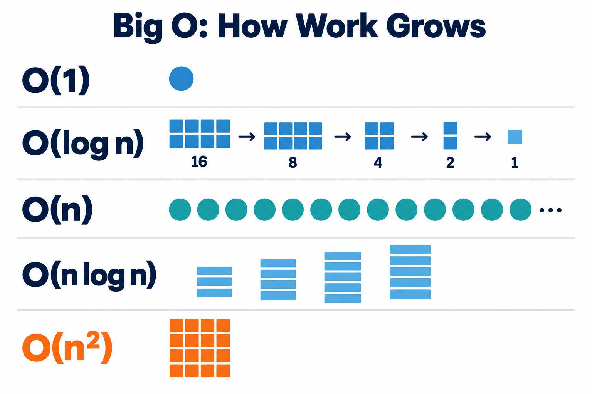

# Big O in Python: A Beginner's Guide

Big O describes how an algorithm's work grows when its input grows. It does **not** tell us the exact running time in seconds.

If a list contains `n` items, Big O asks whether we do the same amount of work, visit every item, compare pairs, or repeatedly cut the work in half. For interviews, recognize the growth pattern; do not count every tiny operation.



## The Big O values you will see most often

| Big O | Plain-English meaning | Common Python example |
|---|---|---|
| `O(1)` | The work stays constant | `nums[0]`, dictionary lookup |
| `O(log n)` | The remaining work is repeatedly divided | Binary search |
| `O(n)` | Visit each item once | One loop over a list |
| `O(n log n)` | A little more than visiting each item | Efficient sorting |
| `O(n²)` | Compare many pairs of items | Two nested loops |
| `O(2ⁿ)` | Try every subset | Include-or-skip recursion |
| `O(n!)` | Try every ordering | Generating all permutations |

As `n` becomes large, `O(1)` grows the slowest and `O(n!)` grows the fastest.

## 1. First decide what `n` means

`n` normally means the size of the input.

```python
nums = [10, 20, 30, 40]
```

Here, `n` is the number of values in `nums`, so `n = 4`.

If the code has two unrelated inputs, use two names:

```python
for number in numbers:      # n items
    for word in words:      # m items
        print(number, word)
```

The time is `O(n * m)`, not automatically `O(n²)`, because the lists can have different sizes.

## 2. One loop is usually O(n)

```python
for number in nums:
    print(number)
```

The loop visits every value once. If the list doubles in size, the loop does about twice as much work.

- Time: `O(n)`
- Extra space: `O(1)`

The loop needs only one variable, `number`. It does not create another collection that grows with the input.

## 3. Separate loops are added

```python
for number in nums:
    print(number)

for number in nums:
    print(number * 2)
```

The first loop runs `n` times and the second runs `n` times: `n + n = 2n`. Big O ignores fixed multipliers such as `2`, so the total time is `O(n)`.

## 4. Nested loops are multiplied

```python
for first in nums:
    for second in nums:
        print(first, second)
```

For each of the `n` values in the outer loop, the inner loop visits all `n` values: `n * n = n²`.

- Time: `O(n²)`
- Extra space: `O(1)`

This version performs fewer comparisons, but it is still `O(n²)`:

```python
for i in range(len(nums)):
    for j in range(i + 1, len(nums)):
        print(nums[i], nums[j])
```

It checks roughly half of all possible pairs. Big O ignores that fixed one-half because the work still grows like `n²`.

## 5. Halving the problem means O(log n)

```python
size = 16

while size > 1:
    size //= 2
```

The values are `16 -> 8 -> 4 -> 2 -> 1`, so only four loop iterations are needed. Even `1,024` reaches `1` after ten halvings.

- Time: `O(log n)`
- Extra space: `O(1)`

This pattern appears in binary search. Unless an interviewer says otherwise, `log n` in Big O usually means base 2, but the base does not change the Big O category.

## 6. Count the cost inside the loop

A loop is not always `O(n)` overall. Ask how expensive its body is.

### Searching a set

```python
seen = set()

for number in nums:
    if number in seen:
        return True
    seen.add(number)
```

A set membership check is `O(1)` on average, and we do it up to `n` times.

- Time: `O(n)` on average
- Extra space: `O(n)`

### Searching a list

```python
for number in nums:
    if number in another_list:
        return True
```

Python may scan all of `another_list` to decide whether `number` is present. If both lists contain `n` items, the worst-case time is `n * n = O(n²)`.

The general rule is:

```text
number of repetitions * cost of each repetition
```

## 7. Fixed work is O(1)

```python
for i in range(100):
    print(i)
```

This loop always runs exactly 100 times. Its work does not grow with the input, so it is `O(1)`. `O(1)` does not mean one operation; it means a fixed amount of work.

## 8. Common recursion patterns

### One call reduces `n` by 1

```python
def countdown(n):
    if n == 0:
        return

    countdown(n - 1)
```

There are `n` calls before the base case.

- Time: `O(n)`
- Extra space: `O(n)`

The space is `O(n)` because every unfinished call waits on Python's call stack.

### One call halves the problem

A recursive binary search keeps only half of the search area each time.

- Time: `O(log n)`
- Extra space: `O(log n)` for a recursive version
- Extra space: `O(1)` for an iterative version

### Two calls create a branching tree

```python
def fibonacci(n):
    if n <= 1:
        return n

    return fibonacci(n - 1) + fibonacci(n - 2)
```

This simple version repeats calculations many times. Its time is exponential, commonly simplified to `O(2ⁿ)` in interviews. Memoization can reduce it to `O(n)` time.

## 9. Space complexity means extra memory

Interviewers usually mean **auxiliary space**: memory created by the algorithm, not the memory already used by its input.

### Constant extra space

```python
total = 0

for number in nums:
    total += number
```

Only `total` and `number` are stored, regardless of how large `nums` becomes.

- Time: `O(n)`
- Extra space: `O(1)`

### Linear extra space

```python
result = []

for number in nums:
    result.append(number * 2)
```

`result` grows by one item for every input item.

- Time: `O(n)`
- Extra space: `O(n)`

### Quick space guide

| Extra memory created | Auxiliary space |
|---|---|
| A few variables | `O(1)` |
| A list, set, or dictionary with up to `n` items | `O(n)` |
| An `n` by `n` matrix | `O(n²)` |
| A recursion stack `n` calls deep | `O(n)` |
| A recursion stack `log n` calls deep | `O(log n)` |

A loop can take a long time without using much memory. Analyze time and space separately.

## 10. A five-step interview method

When an interviewer shows you code, ask:

1. **What is `n`?** Identify the input size.
2. **How many times does the code repeat?** Check loops and recursive calls.
3. **What does each repetition cost?** A set lookup is usually `O(1)` on average; a list search is `O(n)`.
4. **What new memory grows with the input?** Check collections, matrices, and the recursion stack.
5. **Which case am I describing?** Say whether it is the worst, average, or best case. Interviews usually expect the worst case unless stated otherwise.

Then say your reasoning aloud:

> The outer loop runs `n` times. The list search inside can take `n` steps, so the worst-case time is `O(n²)`. No growing data structure is created, so the extra space is `O(1)`.

## Practice quiz

Try each question before opening its answer.

### Question 1

```python
for i in range(n):
    print(i)
```

<details>
<summary>Answer</summary>

- Time: `O(n)` because the loop runs `n` times.
- Extra space: `O(1)` because only `i` is added.

</details>

### Question 2

```python
for i in range(n):
    for j in range(i + 1, n):
        print(i, j)
```

<details>
<summary>Answer</summary>

- Time: `O(n²)` because the code visits roughly `n(n - 1) / 2` pairs.
- Extra space: `O(1)` because it creates no growing collection.

</details>

### Question 3

```python
seen = set(nums)
```

<details>
<summary>Answer</summary>

- Average time: `O(n)` because Python inserts `n` values into the set.
- Extra space: `O(n)` because the set can contain up to `n` distinct values.

</details>

### Question 4

```python
while n > 1:
    n //= 2
```

<details>
<summary>Answer</summary>

- Time: `O(log n)` because every iteration halves `n`.
- Extra space: `O(1)` because only the existing variable changes.

</details>

### Question 5

```python
result = []

for i in range(n):
    for j in range(n):
        result.append((i, j))
```

<details>
<summary>Answer</summary>

- Time: `O(n²)` because the nested loops run `n * n` times.
- Extra space: `O(n²)` because `result` stores `n²` pairs.

</details>

## What to memorize first

1. `O(1)` — fixed work
2. `O(log n)` — repeatedly halve the problem
3. `O(n)` — visit every item once
4. `O(n log n)` — common efficient sorting time
5. `O(n²)` — compare many pairs

The most useful habit is not memorizing symbols. It is explaining **why** the work and memory grow that way.
