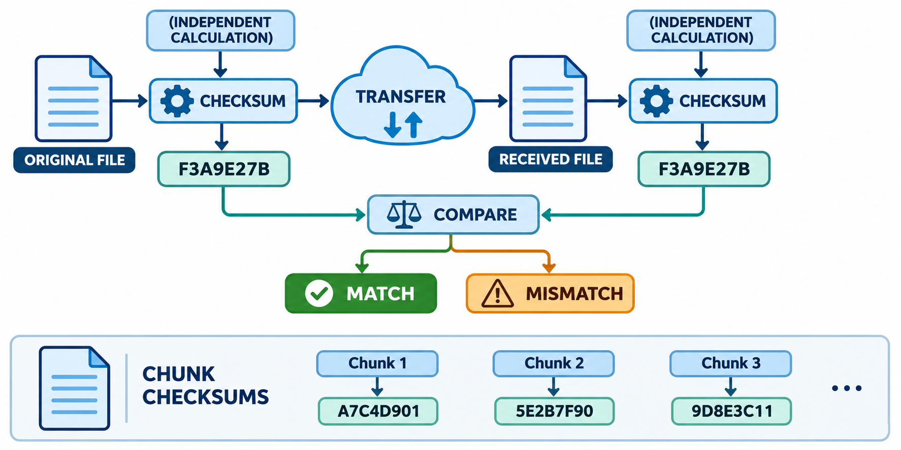
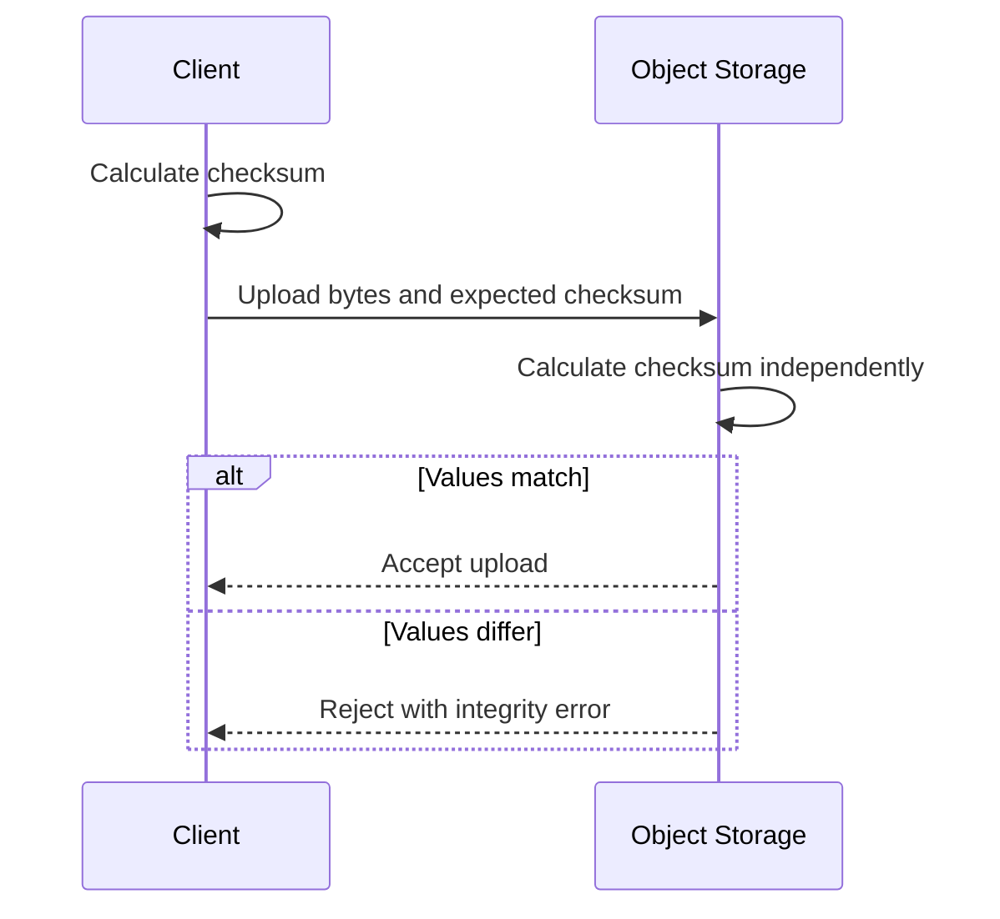
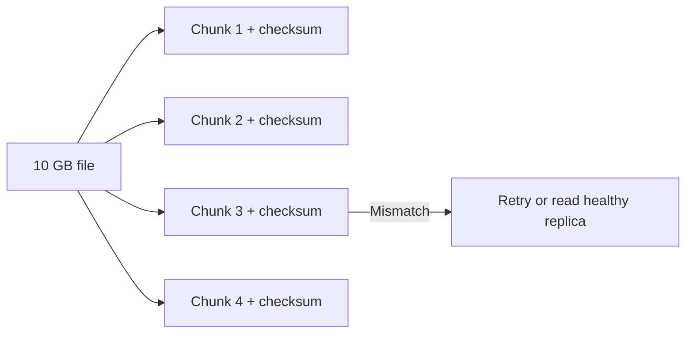

# Checksums and Data Integrity

> **Interview definition:** A checksum is a compact value calculated from data and compared later to detect accidental changes or corruption. It detects a mismatch; it does not repair the damaged data or prove who created it.



## Mental Model

```text
Original data ──calculate──> expected checksum
      │
      └──── transfer or store data ────> received data
                                              │
                                        calculate again
                                              │
                                              ↓
expected checksum ─────────────────────── compare
                                     match / mismatch
```

A checksum answers one narrow question: **Are these bytes consistent with the expected bytes?**

If the values differ, the data definitely changed or the wrong value was compared. If the values match, confidence depends on the algorithm and threat model. Every fixed-size checksum has possible collisions, where two different inputs produce the same value.

## Why Checksums Exist

Imagine uploading a 100 MB file to object storage. The request succeeds, but the file passes through several components:

1. The client reads bytes from disk.
2. Network and transport layers move those bytes.
3. A server receives them.
4. The storage system writes them to media.
5. A future download reads and transfers them again.

A network fault, damaged storage sector, incomplete write, memory error, or software bug can alter data along that path. The sender and receiver can independently calculate the same checksum algorithm over the bytes. A mismatch reveals that something went wrong.

Checksums are useful for:

- File upload and download verification
- Storage scrubbing and replica validation
- Network frame, packet, and segment error detection
- Message and log-record validation
- Content-addressed artifacts and image digests
- Deduplication and change detection, when supported by an appropriate hash

The expected checksum must come from a trustworthy place. If an attacker can replace both a file and the unprotected checksum beside it, an ordinary hash comparison proves nothing about authenticity.

## A Checksum from First Principles

Consider a deliberately weak algorithm that adds three numbers:

```text
Data:      10, 20, 30
Checksum:  10 + 20 + 30 = 60
```

The receiver obtains `10, 21, 30`, recalculates the sum as `61`, and detects a mismatch.

This algorithm misses many changes:

| Original data | Received data | Result | Detected? |
|---|---|---:|---|
| `10, 20, 30` | `10, 21, 30` | 61 | Yes |
| `10, 20, 30` | `30, 20, 10` | 60 | No |
| `10, 20, 30` | `11, 19, 30` | 60 | No |

The example shows why the algorithm matters. A useful checksum must detect the error patterns expected in its environment. A security-sensitive hash must additionally resist an adversary deliberately searching for collisions or alternative inputs.

## Checksums, Hashes, MACs, and Signatures

These terms overlap, but they do not provide the same guarantee.

| Mechanism | Detects accidental corruption | Resists deliberate substitution | Proves possession of a secret key | Proves control of a private key |
|---|---|---|---|---|
| Simple checksum or CRC | Yes | No | No | No |
| Cryptographic hash such as SHA-256 | Yes | Only if the expected digest is trusted | No | No |
| HMAC | Yes | Yes | Yes, for a shared secret | No |
| Digital signature | Yes | Yes | No | Yes |

A **cryptographic hash** maps arbitrary-length input to a fixed-size digest. SHA-256 produces 256 bits. Collision resistance makes it computationally impractical to find two inputs with the same digest under current assumptions, but the mathematical possibility still exists.

An **HMAC** combines a cryptographic hash with a shared secret. A party without the key should not be able to create a valid tag for modified data.

A **digital signature** uses a private key to sign data or its digest. Anyone with the corresponding public key can verify the signature. Signatures add origin authentication and support a different trust model from shared-secret HMACs.

None of these mechanisms encrypts the data. Encryption provides confidentiality. Modern authenticated encryption, as used by current TLS cipher suites, combines confidentiality with integrity protection for data in transit.

## Common Integrity Algorithms

| Technique | Main purpose | Typical use | Security note |
|---|---|---|---|
| Parity bit | Detect some bit errors | Simple hardware and communication schemes | Very weak; misses many multi-bit errors |
| Internet checksum | Detect common transmission errors | IPv4 header, TCP, and UDP | 16-bit one's-complement checksum; not cryptographic |
| CRC-32 / CRC-32C | Fast detection of common corruption patterns | Networks, storage, Kafka record batches | Not safe against intentional modification |
| MD5 | Legacy 128-bit digest | Old file checks and compatibility | Collision-broken; do not use as a security boundary |
| SHA-256 | Cryptographic content digest | Artifact verification and trusted manifests | Trust in the expected digest is still required |

### Internet checksum

The Internet checksum groups adjacent bytes into 16-bit words, adds them using one's-complement arithmetic, and complements the result. Its small size and algebraic structure make it efficient, but it is intended for error detection rather than adversarial integrity.

### CRC

A Cyclic Redundancy Check treats the bit sequence as a polynomial and calculates a remainder using binary polynomial arithmetic. The chosen polynomial determines which error patterns are guaranteed or likely to be detected. CRC-32 and CRC-32C use different polynomials and are not interchangeable.

CRCs are fast and often have hardware acceleration. They are well suited to detecting accidental bit flips and burst errors. Because an attacker can deliberately modify data and recompute the CRC, they are not authentication mechanisms.

### SHA-256

SHA-256 is part of the SHA-2 family. It processes input in blocks and produces a 256-bit digest, usually displayed as 64 hexadecimal characters.

```text
SHA-256("hello") =
2cf24dba5fb0a30e26e83b2ac5b9e29e
1b161e5c1fa7425e73043362938b9824
```

Even a small input change normally produces a very different digest. This is the avalanche effect. Do not infer that similar files will have similar SHA-256 values.

## Collision Risk and Digest Size

A collision occurs when two different inputs produce the same checksum. Because a fixed-size output represents infinitely many possible inputs, collisions must exist.

What matters is how easily they can be found:

- A 32-bit CRC has about 4.3 billion possible values. At large scale, accidental collisions are plausible because of the birthday effect.
- SHA-256 has an enormously larger output space and is designed to resist deliberate collision searches.
- MD5 has known practical collision attacks, so a matching MD5 must not establish security-sensitive authenticity.

For accidental corruption, a CRC may be exactly the right engineering choice. For verifying an artifact against a digest obtained through a trusted channel, SHA-256 is a better default. Algorithm strength should match the threat model rather than the word “checksum.”

## Verifying a File in Python

Read large files incrementally rather than loading them entirely into memory:

```python
from hashlib import sha256
from pathlib import Path


def calculate_sha256(path: Path, chunk_size: int = 1024 * 1024) -> str:
    digest = sha256()

    with path.open("rb") as file:
        while chunk := file.read(chunk_size):
            digest.update(chunk)

    return digest.hexdigest()


expected = calculate_sha256(Path("original.pdf"))
actual = calculate_sha256(Path("downloaded.pdf"))

if actual == expected:
    print("File integrity verified")
else:
    print("Checksum mismatch")
```

The chunk size changes memory and I/O behavior, not the final SHA-256 result. Updating one hash object with all chunks in order is equivalent to hashing the same bytes in one call.

In a real verification flow, do not calculate `expected` from an untrusted downloaded file. Obtain it from trusted metadata, a signed release manifest, an authenticated API, or another protected source.

## Object Storage Upload Example

A checksum-aware upload flow is:



The exact API matters. The client and service must agree on:

- Algorithm, such as CRC-32C or SHA-256
- Representation, such as raw bytes, hexadecimal, or Base64
- Scope, such as one part, a composite of part checksums, or the complete object
- Byte order and any framing included in the calculation

Amazon S3 supports several checksum algorithms and validates supplied checksum values for supported upload operations. For multipart uploads, a checksum may describe individual parts, a composite value derived from part checksums, or, for supported CRC algorithms, the full object. A multipart S3 ETag must not be assumed to be the MD5 digest of the complete object.

That last point is a common interview and production mistake. Treat an ETag as service metadata unless the provider explicitly documents the conditions under which it equals a content digest.

## Why TCP and HTTPS Are Not the Whole Answer

Integrity checks exist at different scopes:

```text
Application     SHA-256 or object checksum  → end-to-end content
TLS             authentication tag          → protected connection
TCP/UDP         Internet checksum           → transport segment/datagram
Ethernet        CRC                          → one network link
Storage         block or sector checksum     → data at rest
```

Each layer protects a different boundary. An Ethernet frame can pass its CRC, then data can be corrupted in memory after validation. A later network hop calculates a new valid CRC over those already-corrupted bytes. TLS protects the connection between its endpoints, but data can still be corrupted by a bug before encryption or after decryption.

An application-level checksum can cover the original content across transfer, storage, replication, and later retrieval. This is the **end-to-end principle**: checks at lower layers are valuable, but only an end-to-end check can validate the application object against its original expected value.

Do not overstate the weakness of TCP. Its checksum detects many accidental transmission errors, and TLS adds strong integrity protection in transit. The reason for an application checksum is scope, durable verification, and defense in depth, not the claim that lower layers do nothing.

## Large Files and Chunk Checksums

For a 10 GB file, one whole-file checksum can detect corruption but cannot locate the damaged region. Dividing the file into chunks makes verification and recovery more precise.



Per-chunk checksums enable:

- Parallel upload and download
- Retry of only a damaged or failed chunk
- Verification while streaming
- Identification of the damaged region
- Repair from a healthy replica in distributed storage

They also create design choices:

- Chunk boundaries and chunk size must remain unambiguous.
- Part order must be protected; valid chunks in the wrong order produce the wrong object.
- Metadata must record the algorithm and expected checksum for every chunk.
- A whole-object checksum is still useful to validate final assembly.
- Changing chunk size changes part-level metadata even when content remains the same.

HDFS, for example, stores checksums for data and verifies content when a client reads it. If a replica is corrupt, a client can retrieve the block from another DataNode. This demonstrates the separation between **detection** and **recovery**: the checksum finds the problem; replication supplies a healthy copy.

## Checksums in Distributed Systems

### Storage scrubbing

A storage service periodically reads data, recalculates its checksum, and compares it with stored integrity metadata. This detects latent corruption before the only good copy is lost. If replicas exist, the service can repair the damaged copy from a healthy one.

### Replication and anti-entropy

Replicas can compare hashes for blocks, partitions, or Merkle-tree ranges rather than transferring every byte. A mismatch narrows the region that needs reconciliation. The hash structure finds divergence; the replication protocol decides which version is authoritative.

### Content-addressed storage

Some systems use a cryptographic digest as an identifier for immutable content. Docker image manifests and layers, for example, can be addressed by SHA-256 digests. Changing the bytes changes the identifier with overwhelming probability.

Content addressing does not by itself establish who published an artifact. Signatures, trusted registries, authenticated metadata, and authorization remain separate controls.

### Logs and messaging

Append-only logs can store a CRC with a record or record batch. On read or replication, a mismatch identifies corruption before invalid bytes reach consumers. Apache Kafka's modern record-batch format uses CRC-32C over the relevant batch fields and record data.

## Checksum Storage and Trust

Where the expected value is stored determines what failures can be detected.

```text
Data and checksum on the same damaged disk
    → may both be lost or corrupted together

Checksum in protected metadata or another failure domain
    → stronger detection of storage corruption

Hash published beside a compromised download
    → weak against an attacker who can replace both

Signed manifest distributed through a trusted channel
    → detects tampering and authenticates the publisher's key
```

Protect the checksum's algorithm identifier, scope, object version, and chunk ordering as well as the digest value. Comparing a correct checksum against the wrong version of a file produces a valid mismatch but a misleading diagnosis.

## Production Considerations

### Choose the algorithm by threat model

Use CRC-32C or another documented fast checksum when accidental corruption is the concern and throughput matters. Use a modern cryptographic hash when an untrusted party may manipulate content, but make sure the expected digest itself is authenticated. Use HMAC or signatures when authenticity is required.

### Calculate while streaming

Hash bytes as they are already being read or written. A second full pass doubles I/O and can dominate cost for large objects. Some protocols support trailing checksums so the final value can be sent after streaming the content.

### Specify the format

Persist the algorithm with the digest:

```text
sha256:2cf24dba5fb0a30e...
```

A bare value is ambiguous. Hexadecimal and Base64 encodings of the same digest are different strings, and CRC variants with similar names may use different polynomials or initialization rules.

### Verify at meaningful boundaries

Verification may be needed:

- Before accepting an upload
- After assembling multipart content
- After replication
- During periodic at-rest scrubbing
- Before serving a high-value artifact
- After download at the consumer

Verifying only during the initial upload does not detect corruption that occurs months later.

### Define recovery behavior

On mismatch, decide whether to reject, retry, quarantine, read another replica, restore from backup, or alert an operator. Bound automatic retries so a persistent mismatch does not create a retry storm.

### Measure integrity failures

Track checksum failures by stage, algorithm, storage device, network path, software version, and object type. Alert on changes in rate rather than treating every mismatch as an isolated client error.

## Common Mistakes

- Saying that a checksum guarantees two files are identical.
- Using MD5 to defend against a malicious collision or substitution.
- Publishing a SHA-256 value on the same compromised channel as the file and calling it authenticated.
- Treating encryption and checksums as interchangeable.
- Assuming an object-storage ETag is always the whole-file MD5.
- Comparing digests produced by different algorithms or encodings.
- Hashing text without defining its character encoding and newline normalization.
- Verifying chunks but not their order or the final assembled object.
- Detecting a mismatch without designing retry, replica repair, or restore behavior.
- Loading a multi-gigabyte file into memory only to calculate its digest.

## Algorithm Comparison

| Approach | Speed and size | Best fit | Limitation |
|---|---|---|---|
| Simple sum or byte count | Extremely cheap | Teaching or very weak sanity checks | Misses many ordinary changes |
| Internet checksum | Cheap, 16 bits | Network protocol compatibility | Weak error detection; not secure |
| CRC-32C | Very fast, 32 bits | High-throughput corruption detection | Short digest and no adversarial protection |
| SHA-256 | More CPU, 256 bits | Trusted artifact and content verification | Does not authenticate an untrusted expected digest |
| Per-chunk checksums | Extra metadata per chunk | Large transfers and targeted repair | More coordination and metadata |
| Whole-object checksum | One value per object | Final end-to-end verification | Does not locate the damaged region |

## Interview Framework

For a system-design question about data integrity:

1. **Define the threat.** Accidental corruption, malicious tampering, or both?
2. **Define the protected scope.** Packet, chunk, complete object, database page, or replicated partition?
3. **Choose the mechanism.** CRC for fast corruption detection; SHA-256 plus a trusted digest for stronger content verification; HMAC or signatures for authenticity.
4. **Choose the verification boundaries.** Upload, assembly, storage, replication, download, or all of them.
5. **Handle large data incrementally.** Stream calculations and use chunk checksums where targeted retry matters.
6. **Protect metadata.** Store algorithm, digest, version, length, and chunk order in a trustworthy place.
7. **Design recovery.** Retry a chunk, read another replica, restore a backup, or quarantine the object.
8. **Add observability.** Record mismatch rates and correlate them with paths, hosts, disks, and software versions.

An interview-ready answer might be:

> For a 5 GB video upload, I would use multipart transfer and calculate a checksum for each part while streaming. The storage service would validate each supplied checksum, allowing only a failed part to be retried. After assembly, I would verify a whole-object checksum or a provider-supported equivalent to catch missing, duplicated, or reordered content. CRC-32C is suitable for high-throughput accidental-corruption detection; if the file comes from an untrusted source and authenticity matters, I would verify a SHA-256 digest from signed metadata or use a digital signature. A mismatch detects the problem, while retransmission, a healthy replica, or a backup provides recovery.

## Check Your Understanding

### 1. Matching checksums prove two files are identical. True or false?

<details>
<summary>Answer</summary>

False. Collisions are possible. The strength of the evidence depends on the algorithm and whether the expected value is trustworthy.

</details>

### 2. Why is CRC-32C often used in high-throughput storage or messaging?

<details>
<summary>Answer</summary>

It is fast, often hardware-accelerated, and designed to detect common accidental corruption patterns. It is not intended to stop deliberate tampering.

</details>

### 3. Why might per-chunk checksums be better than only one whole-file checksum?

<details>
<summary>Answer</summary>

They identify which chunk is damaged and allow targeted retry or repair. A whole-object checksum remains useful for validating final assembly.

</details>

### 4. Why is a SHA-256 value on the same download page insufficient against a compromised server?

<details>
<summary>Answer</summary>

An attacker who controls the page may replace both the file and the displayed digest. The expected digest needs an authenticated channel or a valid digital signature.

</details>

### 5. What repairs data after a checksum mismatch?

<details>
<summary>Answer</summary>

Not the checksum. Recovery requires retransmission, another healthy replica, a backup, or another authoritative copy.

</details>

## Interview Takeaway

> A checksum is a detector, not a repair mechanism or an identity proof. Choose the algorithm from the threat model, verify at the correct end-to-end boundary, protect the expected value, and pair detection with a recovery path.

Related topics:

- [Fault Tolerance](Fault_Tolerance.md): redundancy, replicas, recovery, and observability
- [OSI Model for System Design Interviews](OSI_Model.md): integrity checks at network and transport layers
- [Load Balancing Algorithms](Load_Balancing.md): checksums and hashes solve different system-design problems

## Sources

- [Amazon S3: Checking object integrity for data uploads](https://docs.aws.amazon.com/AmazonS3/latest/userguide/checking-object-integrity-upload.html)
- [RFC 1071: Computing the Internet checksum](https://www.rfc-editor.org/rfc/rfc1071.html)
- [NIST FIPS 180-4: Secure Hash Standard](https://csrc.nist.gov/pubs/fips/180-4/upd1/final)
- [Apache Hadoop: HDFS Architecture](https://hadoop.apache.org/docs/current/hadoop-project-dist/hadoop-hdfs/HdfsDesign.html)
- [Apache Kafka: Message format](https://kafka.apache.org/documentation/#messageformat)
