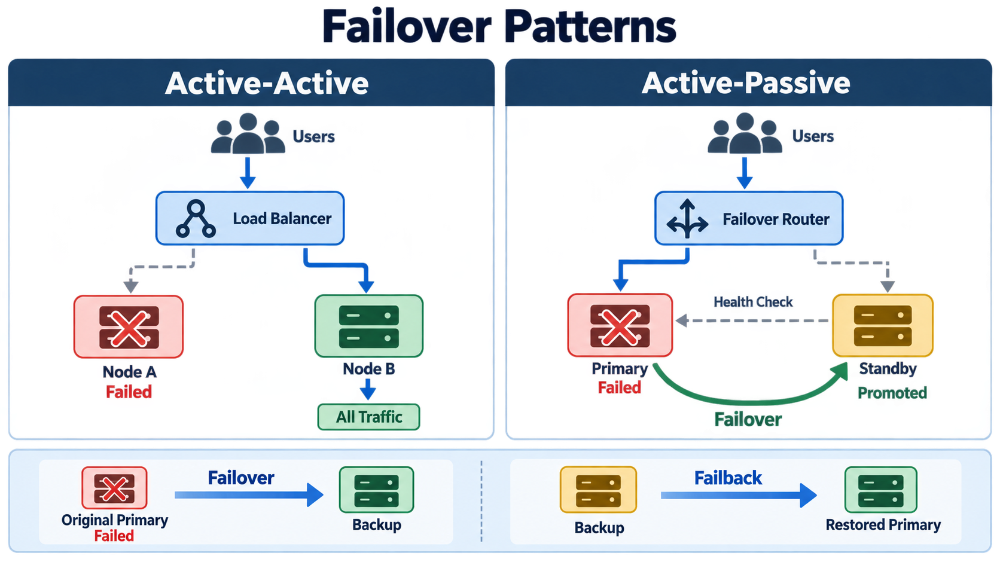

# Failover

> **Interview definition:** Failover is the automatic or controlled transfer of a workload from a failed or unhealthy primary resource to a healthy redundant resource so the service remains available.



## Mental Model

```text
Primary serves traffic
        ↓
Health check detects failure
        ↓
System selects a healthy backup
        ↓
Traffic and responsibility move
        ↓
Backup becomes active
```

Failover is a **mechanism** used to build [fault-tolerant systems](Fault_Tolerance.md). It requires more than keeping a spare server nearby:

- A redundant resource capable of doing the same work
- Health checks or heartbeats that detect failure
- A decision mechanism that prevents conflicting primaries
- Routing or orchestration that moves the workload
- Synchronized configuration and state
- Enough spare capacity to carry the failed component's load
- A tested recovery and failback procedure

## Basic Example

Normal operation:

```text
Users → Primary Server ✅
              |
              └── Standby Server 💤
```

After the primary fails:

```text
Primary Server ❌

Users → Standby Server ✅
              ↑
           failover
```

Failover may be fully automatic, require an operator's approval, or be entirely manual. Greater automation usually reduces recovery time but requires stronger safeguards against false detection and split-brain.

## How Failover Works

1. **Monitor:** health checks, heartbeats, or dependency probes observe the primary.
2. **Declare failure:** the system distinguishes a real failure from a slow response or temporary network problem.
3. **Fence the old primary:** the failed or unreachable node is prevented from accepting writes.
4. **Select and promote:** a healthy standby or replica becomes the new primary.
5. **Redirect:** a load balancer, virtual IP, service discovery, or DNS sends traffic to it.
6. **Validate:** the system checks readiness, data consistency, and capacity.
7. **Recover:** operators repair the old primary and later decide whether to fail back.

Detection must balance speed against accuracy. An aggressive timeout shortens failover time but increases the risk that a brief pause or network partition triggers an unnecessary takeover.

## Active-Active vs Active-Passive

| | Active-active | Active-passive |
|---|---|---|
| Normal traffic | All nodes serve requests | Only the primary serves requests |
| Resource utilization | High | Standby is mostly idle |
| Failover delay | Usually very small | Promotion and routing may add delay |
| Capacity planning | Remaining nodes must absorb extra traffic | Standby must handle production load |
| State management | More complex coordination and conflict handling | Usually simpler single-writer model |
| Operational complexity | Higher | Lower |

### Active-active

```text
              Load Balancer
              /           \
             ↓             ↓
        Node A ✅       Node B ✅
          50%             50%

Node A fails:

              Load Balancer
                    |
                    ↓
               Node B ✅
                 100%
```

Both nodes handle production traffic. If one fails, the remaining nodes continue serving requests. They must be provisioned for the failure case: two nodes continuously running near 50% capacity leave little safety margin when one must suddenly carry 100%.

Active-active works naturally for stateless services. Stateful active-active designs require careful handling of concurrent writes, replication, consistency, and conflicts.

### Active-passive

```text
Users → Primary ✅ ── state replication ──→ Standby 💤

After failure:

Users → Promoted Standby ✅
```

The standby does not normally serve production traffic. It stays synchronized and ready for promotion. This design is simpler, but failover can take longer and idle resources still cost money.

A **hot standby** is running and closely synchronized. A **warm standby** has resources available but may need startup or catch-up time. A **cold standby** must be provisioned or restored before it can serve traffic.

## Failover vs Failback

```text
Original Primary ❌ ── failover ──→ Backup becomes active ✅

Backup active ✅ ── failback ──→ Restored Primary ✅
```

- **Failover** moves production to the backup after a failure or planned event.
- **Failback** returns production to the original environment after it is repaired and synchronized.

Failback is not simply reversing a router. Writes made while the backup was active must be synchronized safely, clients must be drained or redirected, and the transition must be monitored for errors.

Sometimes the promoted backup remains the new primary permanently. Avoid unnecessary failback if it adds risk without business value.

## Where Failover Happens

| Layer | Failed component | Possible failover target |
|---|---|---|
| Application | Process, pod, or VM | Another healthy instance |
| Database | Primary database | Synchronized replica |
| Network | ISP, router, or link | Secondary path or provider |
| Availability zone | Entire data center | Deployment in another AZ |
| Region | Regional services | Secondary region |
| Site | Primary production facility | Disaster-recovery site |

A pod replacement inside one cluster is routine high-availability failover. Moving an entire production environment to another region is regional failover and usually part of a disaster-recovery plan.

## Data Consistency and Split-Brain

The hardest part of failover is often correctness, not routing.

If the old primary is unreachable rather than truly dead, promoting a standby can produce two primaries:

```text
Client A → Primary 1 accepts writes
Client B → Primary 2 accepts writes
```

This is **split-brain**. Conflicting writes may corrupt or diverge state. Common protections include:

- Quorum-based leader election
- Fencing or STONITH to disable the old primary
- Leases with expiration
- Consensus protocols
- A single-writer invariant

Replication mode also affects recovery:

- **Synchronous replication** lowers potential data loss but adds write latency and may reduce availability during network faults.
- **Asynchronous replication** improves latency and geographic flexibility but the promoted replica may be behind, producing a non-zero RPO.

## Failover vs Related Concepts

| Concept | Meaning |
|---|---|
| **Retry** | Attempt the same operation again, often on the same logical dependency |
| **Failover** | Move the workload to another healthy resource |
| **Failback** | Return the workload to the original resource after recovery |
| **High availability** | Design for minimal downtime, often using failover |
| **Fault tolerance** | Continue operating despite component failures |
| **Disaster recovery** | Restore a broader system or site after a major disruption |

## Testing Failover

A failover design is incomplete until it is exercised. Test that:

- Failure is detected within the target time.
- The correct standby is selected and promoted once.
- The old primary is fenced.
- Routing changes reach clients quickly enough.
- The backup can sustain peak production load.
- In-flight requests behave predictably.
- Data loss remains within the RPO.
- Service recovery remains within the RTO.
- Failback preserves writes made during the incident.
- Alerts, runbooks, and operator access work during the outage.

Use scheduled failover drills, chaos experiments, and capacity tests. A standby that has never handled production traffic is only an assumption.

## Common Pitfalls

- The standby has different configuration, software, secrets, or schema.
- Health checks detect process liveness but not the ability to serve real traffic.
- A transient network partition triggers false failover.
- DNS caching makes traffic redirection slower than expected.
- The surviving active node lacks capacity for the entire workload.
- Replication lag causes unexpected data loss after promotion.
- Automatic failover creates split-brain because the old primary was not fenced.
- Dependencies such as storage, identity, DNS, or a load balancer remain single points of failure.
- Teams test failover but never test failback.

## Interview Framework

When proposing failover in a system-design interview, explain:

1. **Failure scope:** process, node, AZ, region, or full site.
2. **Topology:** active-active or active-passive, and why.
3. **Detection:** probe type, interval, timeout, and failure threshold.
4. **Decision:** who promotes the backup and how split-brain is prevented.
5. **State:** replication mode, consistency guarantee, and possible data loss.
6. **Routing:** load balancer, virtual IP, service discovery, or DNS.
7. **Capacity:** whether surviving resources can handle peak traffic.
8. **Targets:** expected failover time, RTO, RPO, and availability SLO.
9. **Recovery:** repair, resynchronization, and failback strategy.
10. **Validation:** drills, observability, alerts, and rollback procedures.

## Interview Takeaway

> Failover is not merely "switch to the backup." A complete answer explains how failure is detected, how exactly one replacement is promoted, how traffic and state move safely, whether capacity is sufficient, and how the system eventually recovers.

## Source

- [Druva — Failover Meaning & Definition: How Failover Works](https://www.druva.com/learning-center/glossary/failover)

