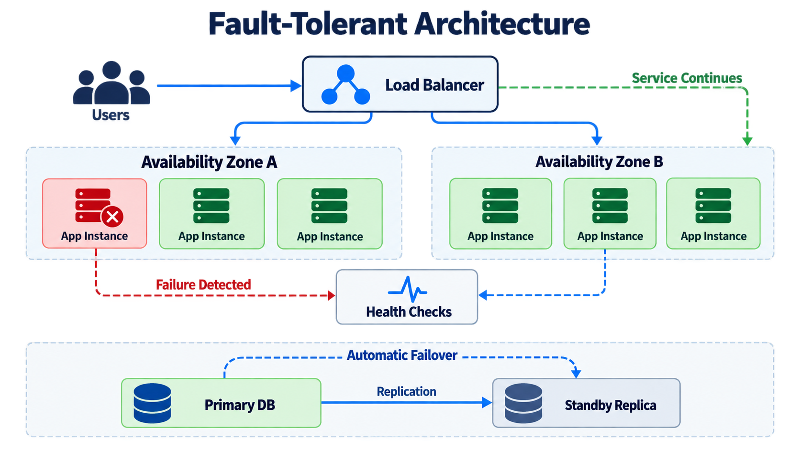

# Fault Tolerance

> **Interview definition:** Fault tolerance is a system's ability to continue operating when one or more components fail.



## Mental Model

```text
Failure occurs
      ↓
Detect the failure
      ↓
Isolate the unhealthy component
      ↓
Reroute work or promote a replica
      ↓
Continue normally or degrade gracefully
```

Fault tolerance is not one feature. It is the result of combining:

- **Redundancy:** more than one component can perform critical work.
- **Failure detection:** health checks, heartbeats, timeouts, and monitoring identify unhealthy components.
- **Failover:** traffic or responsibility moves to a healthy component.
- **Replication:** state exists in more than one failure domain.
- **Retries and timeouts:** transient failures do not immediately become user-visible failures.
- **Idempotency:** retrying an operation does not apply its side effects twice.
- **Checkpointing and recovery:** interrupted work can resume safely.
- **Observability:** operators can understand failures and verify recovery.

## Basic Example: Database Failover

Without redundancy, the database is a single point of failure:

```text
Application → Database ❌ → Application unavailable
```

With a synchronized standby:

```text
                  ┌→ Primary DB ❌
Application ──────┤
                  └→ Standby DB ✅
                         ↑
                  automatic failover
```

The switch to the standby is **failover**. The application's ability to remain useful despite the primary failure is **fault tolerance**.

## Choose a Survival Goal

"Make it fault tolerant" is incomplete. State which failure domains the system must survive.

| Survival goal | Typical design | Main trade-off |
|---|---|---|
| Process or pod failure | Multiple instances behind a load balancer | Extra compute and retry complexity |
| Node failure | Replicas placed on different hosts | Scheduling and state coordination |
| Availability-zone failure | Application and data replicas across AZs | Cross-AZ latency and transfer cost |
| Region failure | Multi-region deployment and global routing | Replication lag, consistency, and much higher cost |
| Cloud-provider failure | Multi-cloud or hybrid deployment | Greatest operational complexity and lowest portability assumptions |

Resilience and cost generally grow together:

```text
Single instance
      ↓
Multiple instances
      ↓
Multiple nodes
      ↓
Multiple availability zones
      ↓
Multiple regions
      ↓
Multiple providers
```

Do not deploy across regions merely to survive a pod failure. Match the architecture to the business impact of the failure.

## Normal Operation vs Graceful Degradation

Two valid recovery goals are:

1. **Normal operation:** users see little or no change after a failure. A healthy replica immediately takes over.
2. **Graceful degradation:** non-critical features become unavailable, but the core product remains useful.

Example for an e-commerce system:

```text
Search ✅      Checkout ✅      Recommendations ❌
```

The site can still sell products even though personalization is temporarily unavailable. This is often cheaper and simpler than making every feature equally resilient.

## Fault Tolerance vs Related Concepts

| Concept | Question it answers |
|---|---|
| **Fault tolerance** | Can the system keep working when something fails? |
| **High availability** | What percentage of time is the system usable? |
| **Failover** | How does responsibility move to a healthy component? |
| **Disaster recovery** | How is service restored after a major disruption? |
| **Resilience** | How well does the system absorb, recover from, and adapt to failures? |

Fault tolerance helps achieve high availability, but they are not identical. A fault-tolerant service can still lose availability during planned upgrades, migrations, or failures outside its design assumptions.

## Important Recovery Metrics

- **RTO (Recovery Time Objective):** maximum acceptable time to restore service.
- **RPO (Recovery Point Objective):** maximum acceptable amount of data loss, measured in time.

Example: `RTO = 5 minutes` and `RPO = 30 seconds` means service should return within five minutes and lose no more than the latest thirty seconds of data.

These targets influence whether replication is synchronous or asynchronous, whether failover is automatic, and how much redundancy is justified.

## Application-Layer Patterns

### Stateless replicas

Run several service instances behind a load balancer. Health checks stop routing traffic to failed instances, and an orchestrator can replace them.

```text
                 ┌→ Instance A ❌
Load Balancer ───┼→ Instance B ✅
                 └→ Instance C ✅
```

Store sessions and durable state outside the instances so any healthy replica can serve the next request.

### Timeouts, retries, and circuit breakers

- A **timeout** prevents waiting forever for a failed dependency.
- A **retry** handles transient faults, ideally with exponential backoff and jitter.
- A **circuit breaker** temporarily stops calls to a failing dependency so failures do not cascade.

Retries must be bounded. Uncontrolled retries can amplify an outage into a retry storm.

### Queues and durable workflows

A queue decouples producers from temporarily unavailable consumers. A failed worker's message can be retried by another worker, but processing should be idempotent.

```text
1. Worker charges a customer
2. Worker crashes before acknowledging the message
3. Queue redelivers the message
4. Idempotency key prevents a second charge
```

## Data-Layer Patterns

- **Primary-replica:** a standby is promoted when the primary fails.
- **Consensus replication:** a quorum agrees on committed state; the system can tolerate a limited number of replica failures.
- **Backups:** protect against corruption, deletion, and operator error; replicas alone do not.
- **Partitioning:** limits the blast radius, but losing a partition can still make part of the data unavailable.

Replication is not the same as backup. A bad write or deletion may quickly replicate to every replica.

## Common Pitfalls

- Redundant services still depend on one load balancer, database, DNS provider, or network path.
- All replicas are placed in the same node, rack, AZ, or region.
- Failover exists on paper but is never tested.
- A standby is too stale or under-provisioned to take production traffic.
- Split-brain allows two nodes to act as primary.
- Retries repeat non-idempotent side effects.
- Health checks report that a process is alive even though it cannot serve real requests.
- Cascading failures exhaust threads, connections, queues, or downstream capacity.

Use fault injection, chaos testing, game days, and regular restore drills to validate the design.

## Interview Framework

When discussing fault tolerance in a system-design interview:

1. **Identify critical user journeys.** Which operations must remain available?
2. **List failure domains.** Process, host, AZ, region, provider, network, and dependency.
3. **Define targets.** Availability SLO, RTO, RPO, and acceptable degradation.
4. **Remove single points of failure.** Add redundancy only where the targets require it.
5. **Explain detection and failover.** Include health checks, routing, leader election, and recovery time.
6. **Protect correctness.** Discuss consistency, quorum, idempotency, deduplication, and split-brain.
7. **Control cascading failure.** Use isolation, backpressure, timeouts, bounded retries, and circuit breakers.
8. **Test the assumptions.** Demonstrate failover and restore procedures under realistic faults.
9. **State the trade-offs.** More resilience increases infrastructure cost and operational complexity.

## Interview Takeaway

> Start with: **"Which failures must this system survive, and what degraded behavior is acceptable?"** Then connect redundancy, detection, failover, data correctness, and testing to that explicit goal.

## Source

- [Cockroach Labs — What is fault tolerance, and how to build fault-tolerant systems](https://www.cockroachlabs.com/blog/what-is-fault-tolerance/)

