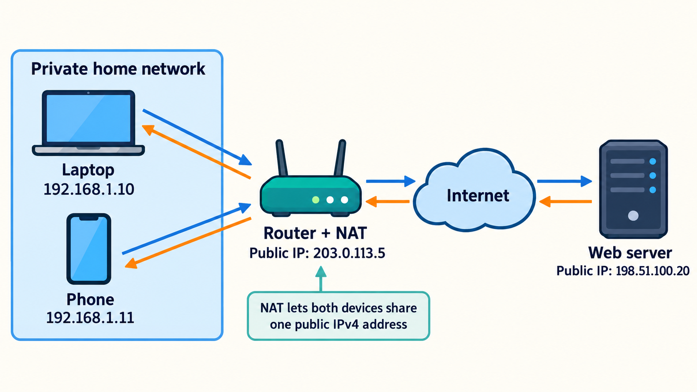

# IP Addresses Explained from the Beginning

> **In simple words:** An IP address tells a network where to send data. It is similar to a street address, but it identifies a location on a computer network.

You do not need any networking knowledge to read this guide. We will start with a laptop and a phone connected to home Wi-Fi, then build toward subnets, cloud networks, NAT, and DNS.

## 1. What Is an IP Address?

Imagine that someone wants to deliver a parcel to your home. They need your address to find the correct place.

Computers have the same problem. When one device sends data, the network needs an address that tells it where the data should go. This is the job of an **IP address**.

IP stands for **Internet Protocol**. A protocol is a set of rules that computers follow when they communicate.

Devices on your home network might have these addresses:

```text
Laptop: 192.168.1.10
Phone:  192.168.1.11
Router: 192.168.1.1
```

A **router** is the device that connects your home network to other networks, including the internet.

An IP address usually belongs to a network connection, not permanently to the physical device. Your laptop may get a different address when it connects to another Wi-Fi network.

## 2. IPv4 and IPv6

There are two main versions of IP.

### IPv4

An IPv4 address looks like this:

```text
192.168.1.10
```

It contains four numbers separated by dots. Each number can be from `0` to `255`.

IPv4 uses 32 **bits**. A bit is the smallest unit of computer data and can be either `0` or `1`. Thirty-two bits provide about 4.3 billion possible combinations, although not every combination can be assigned to a device.

### IPv6

An IPv6 address looks like this:

```text
2001:db8::1
```

IPv6 uses 128 bits, so it provides far more addresses than IPv4. It was introduced because the world has more internet-connected devices than the limited IPv4 address space can support directly.

For interviews, remember:

| Version | Address size | Example | Main point |
|---|---:|---|---|
| IPv4 | 32 bits | `192.168.1.10` | Older, shorter, and still widely used |
| IPv6 | 128 bits | `2001:db8::1` | Newer and provides far more addresses |

You usually do not need to memorize the full IPv6 format for a beginner system design interview.

## 3. Public and Private IP Addresses

Your laptop may have the address `192.168.1.10` at home. This is a **private IP address**. It works inside your home network, but internet routers do not use it to deliver traffic directly to your laptop.

A **public IP address** can be used to communicate across the public internet. Your home router normally has a public IP address on its internet-facing connection.



| Public IP address | Private IP address |
|---|---|
| Used on the public internet | Used inside a private network |
| Must not conflict with another public address being used at the same time | Can be reused in separate private networks |
| Example: `203.0.113.5` | Example: `192.168.1.10` |

Two laptops in different homes can both use `192.168.1.10`. This works because each address exists inside a different private network.

The public addresses in this guide use ranges reserved for documentation. They are examples, not addresses of real public servers.

Common private IPv4 ranges are:

```text
10.0.0.0/8
172.16.0.0/12
192.168.0.0/16
```

The `/8`, `/12`, and `/16` notation is explained below.

## 4. What Is a Subnet?

A **network** is a group of connected devices that can exchange data. A **subnet** is a smaller network created inside a larger address range.

Imagine a company with three departments:

- Engineering
- Finance
- Human Resources

The company can place each department in a separate subnet. Each subnet receives its own range of IP addresses.

Why split a network into subnets?

- To organize devices
- To control how traffic moves
- To apply different firewall rules
- To reduce the number of devices in one network section

A **firewall** follows rules that allow or block network traffic.

Creating subnets does not secure the network by itself. The company must also configure firewall rules and other access controls.

## 5. What Does `/24` Mean?

You may see an address range written like this:

```text
192.168.1.0/24
```

This format is called **CIDR notation**. CIDR stands for Classless Inter-Domain Routing.

An IPv4 address has 32 bits. The `/24` means:

- The first 24 bits identify the network.
- The remaining 8 bits identify addresses inside that network.

To find the total number of addresses, raise 2 to the number of remaining bits:

```text
32 total bits - 24 network bits = 8 remaining bits
2^8 = 256 total addresses
```

A traditional `/24` IPv4 subnet has 256 total addresses. The first address identifies the network, and the last is normally used as the broadcast address. That leaves 254 traditional host addresses.

Cloud providers may reserve more addresses. For example, AWS reserves five IPv4 addresses in every VPC subnet, so an AWS `/24` subnet does not provide 254 addresses for resources.

| CIDR range | Bits left for addresses | Total addresses |
|---|---:|---:|
| `/16` | 16 | 65,536 |
| `/24` | 8 | 256 |
| `/28` | 4 | 16 |

As the number after `/` gets larger, the subnet gets smaller:

```text
/16 -> large network
/24 -> smaller network
/28 -> even smaller network
```

You do not need to memorize every subnet size. Remember the calculation: `2^(32 - prefix length)`.

## 6. What Is a VPC?

VPC stands for **Virtual Private Cloud**. A VPC is a private network that you create inside a cloud provider. AWS calls this network a VPC.

When you create a VPC, you choose its IP address range. For example:

```text
VPC: 10.0.0.0/16
```

You can divide the VPC into smaller subnets:

```text
VPC: 10.0.0.0/16

Public subnet:       10.0.1.0/24 -> Load balancer
Private app subnet:  10.0.2.0/24 -> FastAPI application
Private data subnet: 10.0.3.0/24 -> PostgreSQL database
```

A **load balancer** receives requests and sends them to application servers. FastAPI is a tool for building web applications in Python. PostgreSQL is a database that stores application data.

A public subnet has a route to an **internet gateway**, which connects the VPC to the internet. A resource also needs a public address and suitable security rules before the internet can reach it.

A private subnet has no direct route for incoming internet traffic. This is a useful place for application servers and databases that users should not contact directly.

In this example:

1. The load balancer accepts requests from users.
2. It sends valid requests to the FastAPI application.
3. The application reads or writes data in PostgreSQL.
4. Users never connect directly to the database.

Real production systems often use several subnets in different **availability zones**. An availability zone is a separate group of cloud data centers. Using more than one can help the system continue working when one location has a problem.

## 7. What Is NAT?

NAT stands for **Network Address Translation**. NAT changes address information as traffic moves between networks.

At home, your router usually translates a device's private IP address and port into the router's public IP address and another port. This lets several devices share one public IPv4 address.

```text
Laptop: 192.168.1.10
          |
          v
Router performs NAT
Public IP: 203.0.113.5
          |
          v
Internet
```

The router remembers which device started each connection. When a response returns, the router sends it back to the correct device.

### NAT in AWS

Suppose a FastAPI server is in a private subnet. It needs to call an external AI service, but it has no public IP address.

An AWS public NAT Gateway can provide outbound IPv4 access:

```text
Private FastAPI server
10.0.2.15
      |
      v
Public NAT Gateway in a public subnet
      |
      v
External service on the internet
```

The private subnet sends matching outbound traffic to the NAT Gateway. The NAT Gateway uses a public IPv4 address and sends the traffic to the internet.

The response can return through the connection that the private server started. This does not let internet users freely start new connections to the private server.

## 8. Static and Dynamic IP Addresses

A **static IP address** is intended to stay the same.

A **dynamic IP address** can change. Networks often use DHCP, or Dynamic Host Configuration Protocol, to give devices addresses automatically.

Your laptop might receive `192.168.1.10` today and `192.168.1.15` later. Applications should not assume that a dynamic address will remain unchanged.

In AWS, an **Elastic IP address** is a public IPv4 address that you can allocate to your account and keep until you release it.

### Why this matters in Kubernetes

Kubernetes runs applications in units called **pods**. A replacement pod may get a new IP address:

```text
Old pod: 10.0.2.10
New pod: 10.0.2.25
```

Another application would break if it always tried to contact the old pod IP.

A Kubernetes **Service** provides a stable name and network endpoint for a changing group of pods. Applications can connect to a name such as `payment-service` instead of storing one pod's IP address.

## 9. What Is DNS?

DNS stands for **Domain Name System**. It helps a computer find an IP address from a name that is easier for people to remember.

Think of DNS as a contacts list:

```text
Name in your contacts -> Phone number
example.com           -> IP address
```

When you enter `www.example.com`, your computer asks DNS for an address. DNS may return an address such as `203.0.113.10`. The browser then uses that address to contact the server.

```text
www.example.com
       |
       v
DNS lookup
       |
       v
203.0.113.10
       |
       v
Website server
```

One name can return more than one address. The returned address can also change over time. DNS lets users keep using the same readable name while the system changes behind it.

## 10. Special IPv4 Addresses and Ranges

| Address | Simple meaning |
|---|---|
| `127.0.0.1` | Your own computer; commonly called localhost |
| `0.0.0.0` | When an application listens on this address, it listens on all local IPv4 network interfaces |
| `0.0.0.0/0` | Every possible IPv4 destination; often used in routing and firewall rules |
| `192.168.1.1` | An example private address often used by home routers |
| `169.254.0.0/16` | Link-local addresses used on the local network link |

A **network interface** is a connection that lets a computer use a network, such as its Wi-Fi or Ethernet connection.

For example, this FastAPI command listens only for connections from the same computer:

```bash
uvicorn main:app --host 127.0.0.1 --port 8000
```

This command listens on all IPv4 network interfaces on the computer:

```bash
uvicorn main:app --host 0.0.0.0 --port 8000
```

Listening on `0.0.0.0` does not automatically make the application public. Other devices can connect only if the network route, firewall rules, and other security settings allow it.

## 11. Check Your Understanding

### 1. What is the purpose of an IP address?

<details>
<summary>Answer</summary>

An IP address identifies a network location so devices know where to send data.

</details>

### 2. Can two laptops in different homes use the same private IP address?

<details>
<summary>Answer</summary>

Yes. Private address ranges can be reused in separate private networks.

</details>

### 3. What does `/24` mean in an IPv4 CIDR range?

<details>
<summary>Answer</summary>

The first 24 of the 32 bits identify the network. Eight bits remain for addresses inside that network, giving `2^8 = 256` total addresses.

</details>

### 4. Why might a private cloud server use a NAT Gateway?

<details>
<summary>Answer</summary>

It lets the server start outbound IPv4 connections to the internet without giving the server a public IP address.

</details>

### 5. What does DNS do?

<details>
<summary>Answer</summary>

DNS finds IP addresses for names such as `example.com`.

</details>

## What to Remember for Interviews

Focus on these five ideas:

1. **IP address:** Tells a network where to send data.
2. **Public and private addresses:** Public addresses work across the internet; private addresses work inside private networks.
3. **Subnet and CIDR:** Divide address space into smaller networks and show how large each range is.
4. **NAT:** Translates address information and lets private devices share or use public IPv4 connectivity.
5. **DNS:** Finds IP addresses from readable domain names.

The next step is learning how a full web request works, including DNS, ports, TCP, TLS, routers, and HTTP. See [OSI Model for System Design Interviews](OSI_Model.md) for that larger picture.

## Sources

- [AWS: Subnet CIDR blocks](https://docs.aws.amazon.com/vpc/latest/userguide/subnet-sizing.html)
- [AWS: NAT gateways](https://docs.aws.amazon.com/vpc/latest/userguide/vpc-nat-gateway.html)
- [Kubernetes: Service](https://kubernetes.io/docs/concepts/services-networking/service/)
