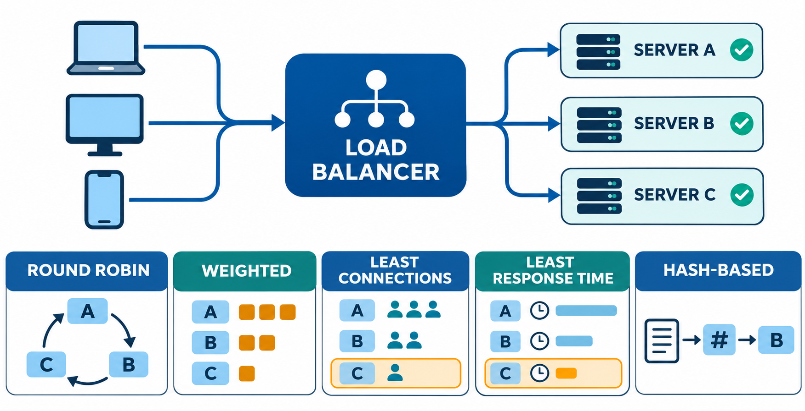
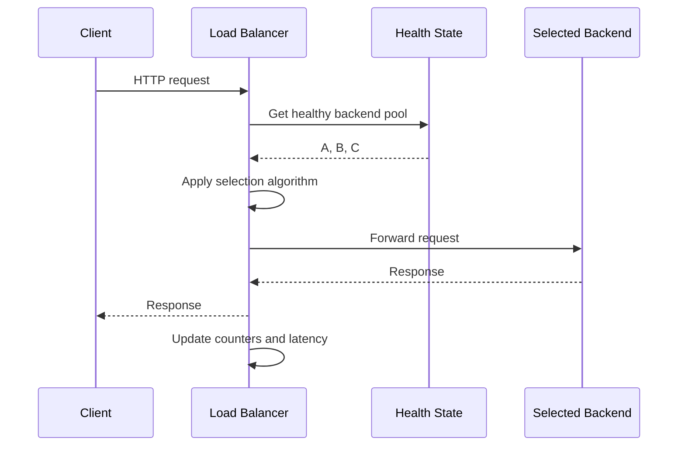
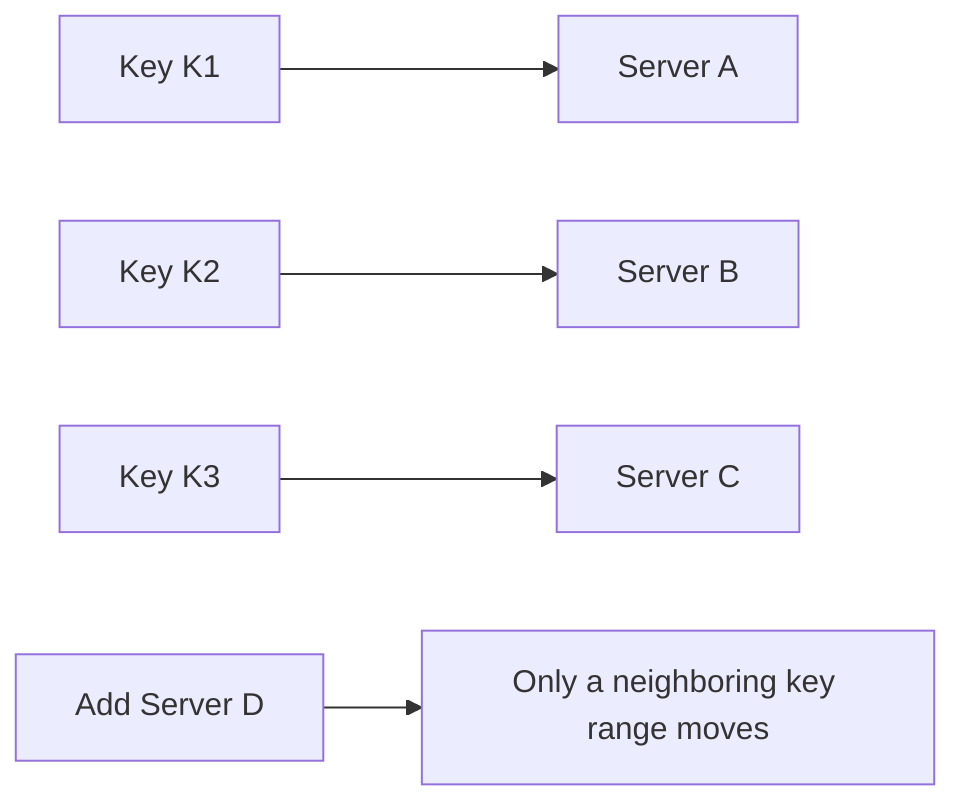
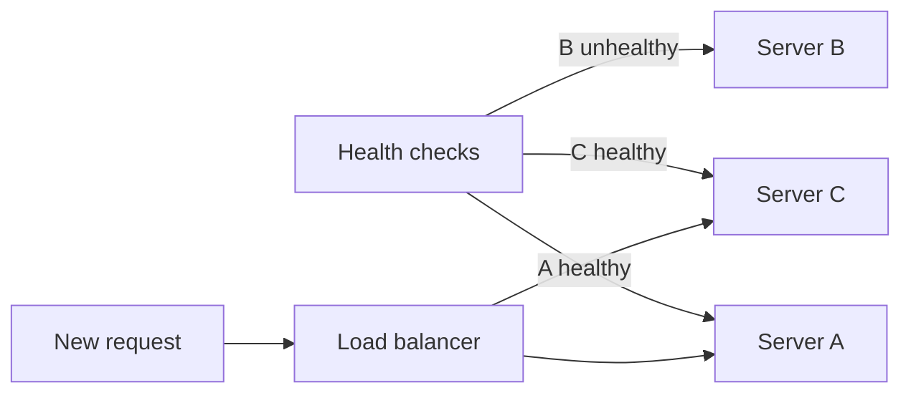

# Load Balancing Algorithms

> **Interview definition:** A load balancer distributes traffic across a pool of healthy backends. The algorithm decides which eligible backend receives each new request or connection.



## Mental Model

```text
Incoming request
       ↓
Remove unhealthy or ineligible backends
       ↓
Apply the configured selection algorithm
       ↓
Forward to the selected backend
       ↓
Update connection and latency measurements
```

Load balancing is not only about dividing requests equally. The objective is to distribute **work** while meeting availability, latency, and affinity requirements. Different algorithms approximate backend load using different signals:

- **Position in a rotation:** Round Robin
- **Configured capacity:** Weighted Round Robin
- **Current activity:** Least Connections
- **Observed performance:** Least Response Time
- **A stable request attribute:** IP Hash or another hash-based policy

No single signal perfectly represents CPU, memory pressure, queue depth, or request cost. Algorithm choice must match the workload.

## How a Load Balancer Handles a Request

A typical Layer 7 reverse-proxy load balancer:

1. Accepts a client connection and reads the HTTP request.
2. Builds an eligible pool from backends that are healthy and ready.
3. Applies the configured algorithm to that pool.
4. Forwards the request, often over a reused backend connection.
5. Returns the response to the client.
6. Updates measurements such as active requests, failures, and response time.



The load balancer normally chooses only among eligible backends. Health checking and backend selection are separate concerns: an excellent algorithm still fails if unhealthy servers remain in the pool.

## Round Robin

Round Robin cycles through the backend list in order.

```text
Requests:  1  2  3  4  5  6
Backend:   A  B  C  A  B  C
```

A minimal implementation is:

```python
class RoundRobin:
    def __init__(self, servers: list[str]) -> None:
        if not servers:
            raise ValueError("at least one server is required")
        self.servers = servers
        self.index = 0

    def get_server(self) -> str:
        server = self.servers[self.index]
        self.index = (self.index + 1) % len(self.servers)
        return server
```

The modulo operation wraps the index back to zero:

| Current index | Calculation | Next index |
|---:|---:|---:|
| 0 | `1 % 3` | 1 |
| 1 | `2 % 3` | 2 |
| 2 | `3 % 3` | 0 |

Round Robin is simple, deterministic, and inexpensive. It works well when servers have similar capacity and requests have roughly similar cost.

Its limitation is that equal request counts do not imply equal work. A 30-second video-processing request and a 50-millisecond cache lookup each count as one request. Connection reuse can also distort distribution because a Layer 4 load balancer may choose a backend once per connection rather than once per HTTP request.

## Weighted Round Robin

Weighted Round Robin gives more traffic to backends with greater configured capacity.

| Server | Relative capacity | Weight | Intended share |
|---|---:|---:|---:|
| A | High | 4 | `4/7` or about 57% |
| B | Medium | 2 | `2/7` or about 29% |
| C | Low | 1 | `1/7` or about 14% |

One valid seven-request schedule is:

```text
A → A → B → A → C → B → A
```

The exact order depends on the implementation. A smooth weighted algorithm spreads a high-weight server's selections across the cycle instead of sending them in one burst. Over time, the proportions should approach the configured weights.

Weights are policy values, not automatic CPU measurements. Operators may derive them from benchmarked throughput, instance size, canary percentage, cost, or operational preference.

Use weighted balancing when:

- The pool contains different instance sizes or hardware generations.
- A replacement fleet is being introduced gradually.
- A small percentage of traffic should reach a canary backend.

Static weights do not reveal current overload. A powerful server can still become slow because of a noisy neighbor, garbage collection, or an expensive request mix.

## Least Connections

Least Connections chooses the backend with the fewest active connections according to the load balancer's counters.

```text
Server A: 10 active connections
Server B:  3 active connections  ← selected
Server C:  7 active connections
```

The load balancer increments a counter when it opens or assigns a tracked connection and decrements it when that connection closes.

```python
active_connections = {"A": 10, "B": 3, "C": 7}

server = min(active_connections, key=active_connections.get)
active_connections[server] += 1
```

Production implementations need a tie-breaking rule and usually combine connection counts with server weights. The counters also describe connections visible to that load balancer, not necessarily every connection reaching a backend through other paths.

Least Connections often helps when connection durations vary or connections are long-lived. It is commonly considered for WebSockets, database proxies, and other connection-oriented workloads.

However, one connection is not one unit of work:

- An idle WebSocket and a busy stream both count as one connection.
- HTTP/2 multiplexes many concurrent requests over one connection.
- A backend may have few connections but high CPU or a deep internal queue.
- Multiple independent load-balancer instances may have different local views of activity.

For request-oriented protocols, a product may use **least requests** or in-flight request counts rather than raw connection counts.

## Least Response Time

A latency-aware policy prefers a backend using measured response time, often together with active connections or in-flight requests.

| Server | Smoothed response time | Active connections |
|---|---:|---:|
| A | 200 ms | 5 |
| B | 80 ms | 4 |
| C | 350 ms | 2 |

Selecting only the lowest last-recorded latency would be unstable. A fast backend could receive a sudden traffic surge, become slow, and then be avoided until its measurement recovers. Practical implementations therefore commonly use a moving average, decay older samples, account for in-flight work, and define behavior for new backends with no history.

This policy is useful when backend performance changes over time and latency measurements correlate with spare capacity. It adds feedback-loop complexity and can make traffic distribution less predictable. Measurements must also distinguish application latency from network latency and load-balancer overhead.

## IP Hash and Request Affinity

IP Hash computes a deterministic value from the client IP address and uses it to choose a backend. A simplified model is:

```python
server_index = stable_hash(client_ip) % len(servers)
server = servers[server_index]
```

If the hash and backend list remain unchanged, the same IP maps to the same backend. This creates a form of **session affinity**, also called a sticky session.

IP-based affinity has important limitations:

- Many users behind the same NAT or corporate proxy may share one public IP and create a hot spot.
- Mobile networks and privacy proxies can change a user's source IP.
- IPv4 and IPv6 paths may produce different keys.
- Adding, removing, or reordering backends can remap many clients with simple modulo hashing.
- The load balancer must obtain the trusted client address correctly when other proxies are in front of it.

For application sessions, a shared store such as Redis or a signed affinity cookie is often more reliable than depending only on source IP. Better still, keep application instances stateless when practical so any healthy backend can handle the next request.

## Consistent Hashing

Simple modulo hashing has a scaling problem:

```text
backend = hash(key) % number_of_backends
```

Changing the number of backends changes the divisor, so many keys map to a different server. For a distributed cache, that can cause a sharp fall in cache-hit rate and a surge of work against the database.

Consistent hashing places backends and keys in a hash space, often visualized as a ring. Each key is assigned to the next backend encountered around the ring.



Adding or removing a backend moves only a portion of the keys rather than potentially remapping most of them. Real systems use many **virtual nodes** or another balancing technique to distribute key ranges more evenly.

Consistent hashing is especially useful for:

- Distributed caches
- Sharded storage
- Routing a tenant, object, or session key to a stable owner

It is not automatically the best choice for ordinary stateless API traffic. Affinity can preserve cache locality, but it can also create hot partitions when a small number of keys dominate traffic.

## Algorithm Comparison

| Algorithm | Selection signal | Strength | Main limitation | Good starting use case |
|---|---|---|---|---|
| Round Robin | Rotation order | Simple and low overhead | Ignores request cost and current load | Similar stateless servers |
| Weighted Round Robin | Rotation plus configured weights | Handles unequal capacity | Weights are static estimates | Mixed instance sizes or canaries |
| Least Connections | Active connection count | Adapts to connection duration | A connection is not a measure of CPU work | Long-lived connections |
| Least Response Time | Smoothed latency, often with active work | Reacts to observed performance | Feedback can oscillate or become stale | Backends with variable latency |
| IP Hash | Client IP | Simple client affinity | NAT, changing IPs, and broad remapping | Limited affinity requirements |
| Consistent Hashing | Request key in a stable hash space | Preserves most mappings as pool changes | Hot keys and added complexity | Caches and sharded state |

The algorithm is only one part of the routing policy. Locality, zone awareness, retries, outlier detection, capacity limits, connection pooling, and slow start can materially change the result.

## Health Checks and Failure Handling

Suppose Server B stops responding. A load balancer should stop selecting it after the configured failure threshold.



Health checks can be:

- **Active:** the load balancer sends dedicated probes, such as `GET /health/ready`.
- **Passive:** real request failures contribute to marking a backend unavailable.

Readiness should test whether a backend can serve new traffic, not merely whether its process exists. Detection also needs thresholds: removing a server after one slow response causes flapping, while waiting too long sends traffic to a failed backend.

In-flight requests may still fail when a server disappears. Retrying is safe only when the operation is idempotent or protected by an idempotency key. Blindly retrying a payment or order creation can duplicate a side effect.

## Production Considerations

### Avoid making the load balancer a single point of failure

Run redundant load balancers, use a managed highly available service, or combine multiple instances with a virtual IP, anycast, or DNS-based routing. The exact mechanism depends on whether balancing is regional, zonal, or local to a cluster.

### Plan for the failure case

If three backends each run at 70% utilization, losing one does not leave enough capacity for the remaining two to absorb the traffic safely. Reserve headroom, scale quickly, shed non-critical load, or degrade gracefully.

### Control connection and request behavior

Configure connection limits, queue limits, timeouts, keep-alive behavior, draining, and graceful shutdown. When removing a backend, stop new assignments before terminating existing requests.

### Observe the distribution

Useful metrics include:

- Requests, connections, and in-flight work per backend
- Response-time percentiles rather than averages alone
- Error and retry rates
- Health-check state changes and flapping
- Queue depth, saturation, and rejected requests
- Distribution skew compared with configured weights

### Separate different workloads when necessary

An algorithm cannot always compensate for radically different request costs. If recommendation generation consumes far more resources than cached product reads, route it to a separately scaled service or worker pool. Architectural isolation is often more effective than tuning one global balancing policy.

## Common Mistakes

- Assuming equal requests mean equal load.
- Using sticky sessions to hide state that should be externalized.
- Treating least connections as a direct measurement of CPU availability.
- Sending traffic to a backend before it is ready after startup.
- Retrying non-idempotent operations after an upstream failure.
- Ignoring HTTP/2 multiplexing and connection reuse.
- Using simple modulo hashing for a cache whose membership changes frequently.
- Forgetting to drain connections during deployments.
- Running one load-balancer instance with no failover plan.
- Choosing an algorithm without measuring whether it improves tail latency or utilization.

## System Design Example

Assume an e-commerce API receives 10,000 requests per second and has five similar application servers. Each server has been load-tested to sustain about 2,500 requests per second for the expected request mix.

Round Robin initially sends roughly 2,000 requests per second to each server, leaving some headroom. That is a reasonable starting point for stateless instances and similar request costs.

Now suppose recommendation requests take much longer than cached product reads. There are several options:

1. Use a policy that accounts for in-flight requests or measured latency.
2. Apply concurrency limits so expensive work cannot consume every worker.
3. Route recommendations to a separate backend pool and scale it independently.

The third option creates a clearer capacity boundary and prevents recommendation spikes from degrading the product API. The best interview answer does not merely name an algorithm; it connects the algorithm to workload shape, failure behavior, and measurement.

## Interview Framework

When asked which load-balancing algorithm to use:

1. **Clarify the balancing unit.** Is the decision per TCP connection, HTTP request, stream, job, tenant, or cache key?
2. **Describe the workload.** Are operations short, long-lived, highly variable, or stateful?
3. **Describe the pool.** Are servers equal, weighted, multi-zone, or frequently added and removed?
4. **State the starting policy.** For similar stateless API servers, Round Robin is a defensible baseline.
5. **Explain when to change it.** Use weights for unequal capacity, active-work signals for variable duration, and hashing for justified affinity or partition ownership.
6. **Cover health and failure.** Discuss readiness checks, draining, retries, idempotency, and load-balancer redundancy.
7. **Name the limitation.** Every algorithm uses an imperfect proxy for actual backend capacity.
8. **Validate with metrics.** Compare tail latency, errors, saturation, and distribution skew under realistic load.

An interview-ready answer might be:

> For a stateless API on equally sized servers, I would start with Round Robin because it is simple and predictable. If requests have highly variable duration, I would evaluate least-request or latency-aware balancing and verify the result with tail-latency and saturation metrics. I would also configure readiness checks, connection draining, bounded retries for safe operations, and redundant load balancers. If server capacities differ, I would introduce weights; if stable key ownership is required for a cache, I would consider consistent hashing.

## Check Your Understanding

### 1. A has 10 active connections, B has 3, and C has 7. Which server does Least Connections choose?

<details>
<summary>Answer</summary>

Server B, assuming all three are healthy, equally weighted, and eligible.

</details>

### 2. Server A has roughly twice the tested capacity of Server B. Which algorithm is a reasonable starting point?

<details>
<summary>Answer</summary>

Weighted Round Robin with relative weights such as `2:1`. The weights should be validated under representative load.

</details>

### 3. Why can Least Connections make a poor decision for HTTP/2 traffic?

<details>
<summary>Answer</summary>

HTTP/2 can multiplex many active requests over one connection, so connection count may not represent the amount of work on each backend.

</details>

### 4. Why is consistent hashing useful for a distributed cache?

<details>
<summary>Answer</summary>

When cache servers are added or removed, it remaps only part of the key space. This preserves more cached data and reduces the miss surge compared with simple modulo hashing.

</details>

### 5. Does removing an unhealthy backend guarantee that all requests succeed?

<details>
<summary>Answer</summary>

No. In-flight requests can still fail, detection takes time, and retries may be unsafe for non-idempotent operations.

</details>

## Interview Takeaway

> Start with the simplest policy that matches the workload, then justify every adaptation with a specific signal: configured capacity, active work, observed latency, or required affinity. The algorithm does not replace health checks, spare capacity, safe retries, observability, or high availability for the load-balancer tier itself.

Related topics:

- [OSI Model for System Design Interviews](OSI_Model.md): Layer 4 and Layer 7 load balancing
- [Fault Tolerance](Fault_Tolerance.md): redundancy, health checks, retries, and graceful degradation
- [Failover](Failover.md): moving traffic away from failed components

## Sources

- [NGINX: Using nginx as HTTP load balancer](https://nginx.org/en/docs/http/load_balancing.html)
- [NGINX: HTTP upstream module](https://nginx.org/en/docs/http/ngx_http_upstream_module.html)
- [Envoy: Load balancing policies](https://www.envoyproxy.io/docs/envoy/latest/intro/arch_overview/upstream/load_balancing/load_balancers)
