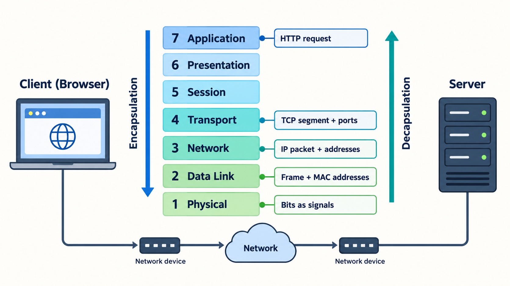

# OSI Model for System Design Interviews

> **In simple words:** The OSI model is a way to understand how data moves from one computer to another. It divides the journey into seven smaller steps, called layers.

You do not need to be a networking expert to use the OSI model. It helps you answer simple questions:

- Which computer should receive the data?
- Which program on that computer should receive it?
- What does the program need to do with it?

For system design interviews, Layers 3, 4, and 7 are the most important.

## What Is a Network Protocol?

A **protocol** is a set of rules that computers follow when they communicate. For example, HTTP defines how a browser asks a web server for a page.

The OSI model groups these communication rules into seven layers. Each layer has one main job.

## The Seven OSI Layers

The layers are numbered from 1 at the bottom to 7 at the top.

| Layer | Name | Simple explanation | Examples |
|---|---|---|---|
| 7 | Application | Lets programs communicate over a network | HTTP, DNS |
| 6 | Presentation | Changes data into a usable format; may encrypt or compress it | JSON, encryption concepts |
| 5 | Session | Starts, manages, and ends a conversation between programs | Login or communication sessions |
| 4 | Transport | Delivers data to the correct program using a port number | TCP, UDP |
| 3 | Network | Finds the correct computer using an IP address | IP, routers |
| 2 | Data Link | Moves data between nearby devices on the same network | Ethernet, Wi-Fi, hardware addresses |
| 1 | Physical | Sends 1s and 0s as real signals | Cables, fiber, radio signals |

You do not need to memorize every detail at first. Remember this:

```text
Layer 7: What does the application want?
Layer 4: Which program should receive the data?
Layer 3: Which computer should receive the data?
```

## How a Web Request Travels

Suppose you open `https://example.com/users` in a browser. HTTPS is the secure version of HTTP, the main protocol browsers and web servers use to communicate.

The browser creates a request that means, "Please give me the `/users` page." That request moves down the OSI layers before it travels across the network.



```text
Browser creates: GET /users
        |
Layer 7 adds the HTTP request
        |
Layer 4 adds port information
        |
Layer 3 adds IP addresses
        |
Layer 2 prepares the data for the local network
        |
Layer 1 sends the data as signals
        |
      Network
        |
The server reads the information in reverse order
```

Each layer adds information that helps deliver the request. This process is called **encapsulation**.

The server removes that information in reverse order. This is called **decapsulation**. The server then gives the original request to the correct application.

## Layer 3, Layer 4, and Layer 7

Think about sending a letter to a large office building:

- The building address tells the delivery service which building to visit.
- The room number tells it which office should receive the letter.
- The message inside tells the person what you want.

A network request works in a similar way.

### Layer 3: Which computer?

Every computer on a network has an **IP address**. An IP address is similar to a building address.

If IP addresses are new to you, read [IP Addresses Explained from the Beginning](IP_Addresses.md) for a step-by-step introduction.

For example:

```text
10.0.0.5
```

Routers are network devices that use IP addresses to move data toward the correct computer.

### Layer 4: Which program?

A computer can run many programs at the same time. A **port number** helps the computer send incoming data to the correct program.

```text
Computer: 10.0.0.5

Port 8000 -> FastAPI web application
Port 5432 -> PostgreSQL database
Port 6379 -> Redis data store
```

The IP address finds the computer. The port number finds the program running on that computer.

Layer 4 commonly uses one of these protocols:

- **TCP:** Checks that data arrives and stays in the correct order.
- **UDP:** Sends data without checking every delivery. It has less overhead but does not guarantee delivery or order.

### Layer 7: What does the program need to do?

Layer 7 contains the request that the application understands.

For example:

```http
POST /workflows/run
```

`POST` asks the application to perform an action. `/workflows/run` tells it which action or resource the request is about.

Here is the full mental model:

```text
IP address -> Which computer?
Port       -> Which program?
HTTP path  -> Which action or resource?
```

## What Is a Load Balancer?

A **load balancer** receives network traffic and sends it to one of several servers. This stops one server from handling every request. It can also avoid a server that is unhealthy.

Load balancers often work at Layer 4 or Layer 7.

## Layer 4 vs. Layer 7 Load Balancers

| Question | Layer 4 load balancer | Layer 7 load balancer |
|---|---|---|
| What information does it use? | IP address, port, and connection | Website name, path, and other request details |
| Does it understand HTTP requests? | No | Yes |
| Can it route `/api` and `/admin` differently? | No | Yes |
| Common AWS example | Network Load Balancer | Application Load Balancer |
| Common use | General network connections | Websites and web services |

For example, a Layer 7 load balancer can send:

```text
/ai/*        -> AI service
/documents/* -> Document service
```

It can do this because it reads the HTTP path. A Layer 4 load balancer does not read that path.

## Using the OSI Model to Find Problems

Suppose a website cannot reach the server that handles its data. The error gives you a clue about where to start looking.

| Problem | What it means | Start by checking |
|---|---|---|
| The domain name does not work | DNS cannot turn the name into an IP address | DNS settings at Layer 7 |
| The IP address cannot be reached | Data cannot find the computer | Addressing and routing at Layer 3 |
| The connection is refused | The program may not be listening on that port | Port, firewall, and program at Layer 4 |
| The browser reports a certificate error | The secure connection could not be verified | TLS certificate settings |
| The server returns HTTP 404 | The application cannot find the requested path | Application routes at Layer 7 |
| The server returns HTTP 500 | The application failed while handling the request | Application code, databases, and other services it uses |

Some terms in this table may be new:

- **DNS** changes a name such as `example.com` into an IP address.
- A **firewall** allows or blocks network traffic based on rules.
- **TLS** protects data sent through HTTPS and proves the server's identity with a certificate.
- An **HTTP status code** is a number that describes the result of a request. For example, `404` means "not found," and `500` means the server had an error.

The OSI layer tells you where to begin. It does not always reveal the exact cause. For example, a Layer 4 connection error may happen because the application stopped running.

## The OSI Model Is a Learning Tool

The internet does not follow the seven OSI layers as seven separate pieces of software. Most real systems use the TCP/IP model, which combines some OSI layers.

That is okay. Use the OSI model to understand a request, explain a design, and find network problems. Do not worry if every real protocol does not fit perfectly into one layer.

## Check Your Understanding

### 1. Which layer uses an IP address to find a computer?

<details>
<summary>Answer</summary>

Layer 3, the Network layer.

</details>

### 2. The request reaches the correct IP address, but port 8000 refuses the connection. Where should you start?

<details>
<summary>Answer</summary>

Start at Layer 4. Check whether the program is running on port 8000 and whether a firewall blocks the connection.

</details>

### 3. You want `/ai` and `/documents` to go to different services. Which load balancer should you use?

<details>
<summary>Answer</summary>

Use a Layer 7 load balancer. It can read the HTTP path and route each request to the correct service.

</details>

### 4. What is the main difference between TCP and UDP?

<details>
<summary>Answer</summary>

TCP checks delivery and order. UDP sends data with less overhead but does not guarantee delivery or order.

</details>

### 5. Does the internet use the OSI model exactly as seven separate layers?

<details>
<summary>Answer</summary>

No. The OSI model is mainly a tool for learning, explaining, and troubleshooting networks.

</details>

## Interview Takeaway

For a system design interview, remember these three questions:

1. **Layer 3:** Which computer should receive the data?
2. **Layer 4:** Which program on that computer should receive it?
3. **Layer 7:** What does the application need to do?

If you can explain those ideas and follow a request from the browser to the server, you understand the most useful part of the OSI model for system design.

## Source

- [AlgoMaster: OSI Model](https://algomaster.io/learn/system-design/osi)
